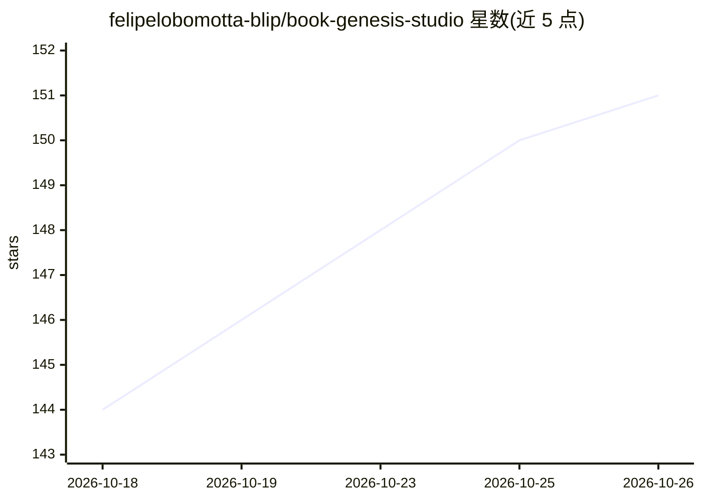

# felipelobomotta-blip/book-genesis-studio

⭐ 151 · Python · MIT · 推送 2026-10-09 · [GitHub](https://github.com/felipelobomotta-blip/book-genesis-studio) · [官网](https://felipelobomotta-blip.github.io/book-genesis-studio/) · 个人维护

**给 AI 编程 agent 的整书创作技能集：从一句话到成书**

面向 Claude Code、Codex、OpenCode 等编码 agent 的写作技能集合：把一句创意驱动为完整书籍，流程含需求建档、人物与章节规划、逐章成稿、四个模拟盲读读者评审、只读审计与受限轮次修订，最终产出报告与 logline/简介/梗概/投稿信/封面简报等编辑包，机器支持时可生成 EPUB 与 PDF。提供 Python 安装器按 agent 安装，另含 beta-reader、editorial-package、literary-agent-panel 三个独立技能。README 声明案例均为维护者本人作品，多数 agent 尚未跑完整本书。

## 筛选速览

| 维度 | 判定 | 备注 |
|---|---|---|
| AI 角色 | `ai-ecosystem` | LLM/agent 周边工具 |
| 许可风险 | `permissive` | MIT |
| 部署形态 | `None` |  |
| 模型依赖 | — | README 未给出锁定关系 |
| 硬件要求 | — | 无带数字的原话,不猜 |
| 安装摩擦 | `low` | 无编译、无系统依赖或容器化 |
| 成熟度 | `idea` | |

## 能力要点

- 五个 agent 为 first class 支持，安装器可列目标/试运行/校验
- 四盲读读者 + 十项 rubric 双门修订，每门至多三轮
- 附 beta-reader、editorial-package、literary-agent-panel 三个独立技能
- 会话状态存于用户文件夹，可跨 agent 断点续写

## 适用场景

- 用 Claude Code/Codex 等编码 agent 从一句创意写完整本书
- 为已有书稿生成简介、梗概、投稿信等编辑包装材料
- 让模拟读者与经纪人面板对书稿做市场适配评审

## 场景标签

`AI 写作` · 领域:内容生成

## 证据(README 行号)

> L5: Give your AI agent an idea, even a one-line one, and Book Genesis takes it to a complete book: planned, written chap
> L34: python runner/installer.py install claude
> L60: - **book-genesis**: the full workflow, with its phase prompts, the three critic roles, the rubric, the patterns lib

## 星数曲线

2026-10-18 144 → 2026-10-26 151（+7）

---
*卡片 v1 · prompt 1.4 · 生成 2026-10-23 · 置信度 high · 依据 README sha `67dc514cac65` · [字段定义](../../DATASET.md)*
