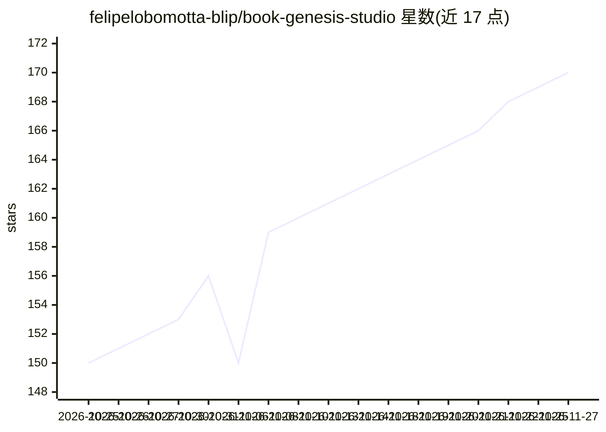

# felipelobomotta-blip/book-genesis-studio

⭐ 170 · Python · MIT · 推送 2026-11-26 · [GitHub](https://github.com/felipelobomotta-blip/book-genesis-studio) · [官网](https://felipelobomotta-blip.github.io/book-genesis-studio/) · 个人维护

**给 AI agent 提供从想法到成书的写作工作流插件**

Book Genesis 为 Claude Code、Codex、OpenCode 等多个 agent 宿主安装一套写作技能：将想法转化为书籍需经过 intake、架构、逐章草稿、盲读者批评、有界修订与导出打包等阶段，输出 manuscript.md 与验证的 EPUB（DOCX/PDF 需既有依赖）。工作流以文件形式保存在用户自己的文件夹中，修订对每个 gate 最多三轮。作者声明为 beta，完整无人值守运行仍在验证，质量 gate 未达成会被记录在交付报告中。附本地 Web UI 与独立安装器。

## 筛选速览

| 维度 | 判定 | 备注 |
|---|---|---|
| AI 角色 | `ai-native` | 本体是模型或模型工具 |
| 许可风险 | `permissive` | MIT |
| 部署形态 | `None` |  |
| 模型依赖 | — | README 未给出锁定关系 |
| 硬件要求 | — | 无带数字的原话,不猜 |
| 安装摩擦 | `low` | 无编译、无系统依赖或容器化 |
| 成熟度 | `idea` | |

## 能力要点

- 四模拟读者盲评 + 十维 rubric 评分 + 只读审计员引用原文
- 修订按读者 gate 与 rubric gate 各限三轮，保留原稿与证据
- 导出 manuscript.md、验证 EPUB 与编辑打包（logline/blurb/synopsis 等）
- 纯 Python 标准库的本地 Web UI，仅监听 localhost

## 适用场景

- 让 AI agent 按阶段流程把一个想法写成完整书籍草稿
- 对已有稿件运行盲读者批评与编辑打包技能
- 独立作者生成 EPUB 与营销文案（hook test、query letter）

## 场景标签

`AI 写作` · 领域:内容生成

## 证据(README 行号)

> L5: Book Genesis gives your AI agent a workflow for turning an idea into a complete book: planning, chapter-by-chapter w
> L48: **Install beta 7 in your existing agent.** No Book Genesis account or separate API key. Python 3.10+ and your host'

## 星数曲线

2026-10-25 150 → 2026-11-27 170（+20）

---
*卡片 v1 · prompt 1.4 · 生成 2026-11-27 · 置信度 high · 依据 README sha `fd9893a1bd1e` · [字段定义](../../DATASET.md)*
