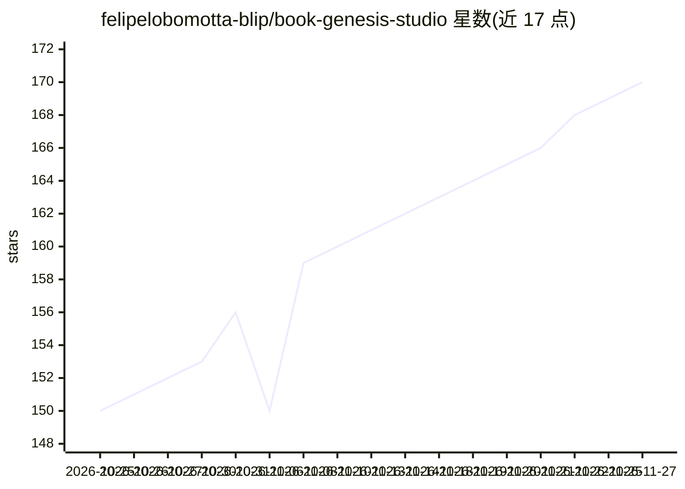

# felipelobomotta-blip/book-genesis-studio

⭐ 170 · Python · MIT · 推送 2026-11-26 · [GitHub](https://github.com/felipelobomotta-blip/book-genesis-studio) · [官网](https://felipelobomotta-blip.github.io/book-genesis-studio/) · 个人维护

**给 AI 编码 Agent 安装的写书工作流插件：从创意到成书导出**

以 Claude Code、Codex 等编码 Agent 为宿主的书稿生成工作流：把用户创意转为 brief，逐章起草并以四个盲模拟读者评审、只读审校、限次修订（每道门槛最多三轮），最终打分并打包输出 manuscript.md 与 EPUB（DOCX/PDF 需依赖存在）。进度以文件形式保存在用户文件夹中，可跨会话续写。通过 Codex/Claude Code 插件市场或独立 Python 安装器安装，需 Python 3.10+ 与 Git，占用用户自身订阅额度。当前为 beta，无人值守完整流程仍在验证中。

## 筛选速览

| 维度 | 判定 | 备注 |
|---|---|---|
| AI 角色 | `ai-native` | 本体是模型或模型工具 |
| 许可风险 | `permissive` | MIT |
| 部署形态 | `None` |  |
| 模型依赖 | — | README 未给出锁定关系 |
| 硬件要求 | — | 无带数字的原话,不猜 |
| 安装摩擦 | `low` | 无编译、无系统依赖或容器化 |
| 成熟度 | `idea` | |

## 能力要点

- 四个盲模拟读者加只读审校的分阶段写书工作流
- 每道门槛最多三轮修订，报告保留未通过项
- 默认导出 manuscript.md 与 EPUB，附 logline/blurb/synopsis 等编辑包
- 批评者在隔离子 Agent 中运行，可选用其他公司的 AI 工具

## 适用场景

- 让 Claude Code 或 Codex 按章节计划代写并修订长篇小说
- 对已有手稿运行盲模拟读者评审与编辑包装
- 独立作者成书后导出 Markdown/EPUB 用于出版准备

## 场景标签

`AI 写作` · 领域:内容生成

## 证据(README 行号)

> L5: Book Genesis gives your AI agent a workflow for turning an idea into a complete book: planning, chapter-by-chapter w
> L25: 1. **Intake.** Your idea becomes a brief: genre, reader, length, comparable books in your idea's language, and four
> L29: 5. **Score and package.** A plain report of where the book stands, plus the editorial package, a hook test of alter

## 星数曲线

2026-10-25 150 → 2026-11-27 170（+20）

---
*卡片 v1 · prompt 1.4 · 生成 2026-11-26 · 置信度 high · 依据 README sha `a6fc486fbdf9` · [字段定义](../../DATASET.md)*
