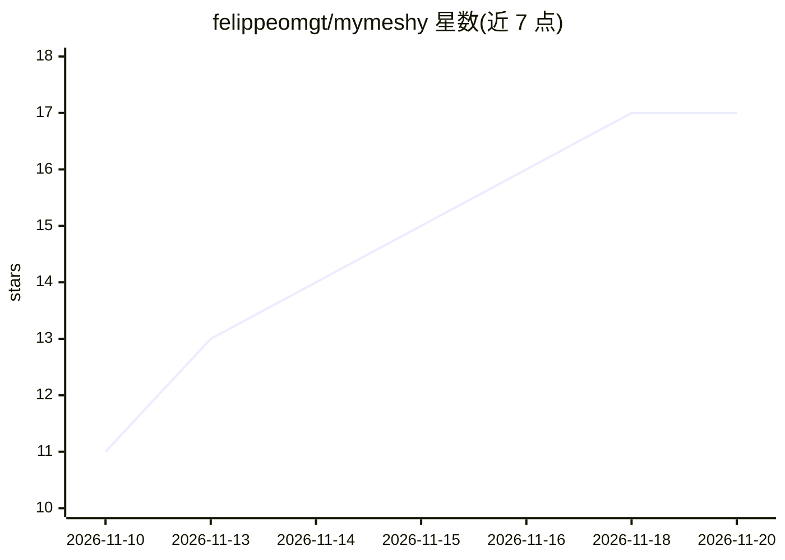

# felippeomgt/mymeshy

⭐ 17 · Python · MIT · 推送 2026-06-12 · [GitHub](https://github.com/felippeomgt/mymeshy) · 个人维护

**本地运行的开源 AI 3D 资产生成工具：文/图生成 3D 模型**

本地优先的 AI 3D 资产生成管线，支持文本→3D、图像→3D、已有网格的提示词/图像贴图，并自动执行网格清理、减面、UV 展开、PBR 纹理烘焙与 GLB/GLTF/OBJ/FBX 导出，附实时查看器与 MCP server（暴露 text_to_3d 等 9 个工具供编码 agent 调用）。后端 Python/FastAPI，前端 React，AI 模型经适配器接口切换，无 NVIDIA GPU 或 macOS 上自动回退到 mock 模式（程序化占位网格）。单 GPU 任务串行执行，FBX 导出依赖外部 Blender。

## 筛选速览

| 维度 | 判定 | 备注 |
|---|---|---|
| AI 角色 | `ai-native` | 本体是模型或模型工具 |
| 许可风险 | `permissive` | MIT |
| 部署形态 | `desktop` | 安装包/桌面程序 |
| 模型依赖 | — | README 未给出锁定关系 |
| 硬件要求 | — | 无带数字的原话,不猜 |
| 安装摩擦 | `high` | 编译与系统依赖俱全 |
| 成熟度 | — | 结构信号不足 |

## 能力要点

- 文本→3D、图像→3D 与网格贴图三条生成管线，输出带 PBR 的可导出模型
- 适配器架构：TRELLIS / Hunyuan3D-2 / TripoSR / SDXL-Turbo 经环境变量切换，auto 回退 mock
- MCP server 暴露 9 个工具，可被 Claude Code / Cursor 调用生成游戏资产
- VRAM 预算控制：≤8GB 时进入低显存模式（SDXL 逐层 CPU offload）

## 适用场景

- 为游戏项目在本地生成低多边形道具、生物、载具等 3D 资产
- 把参考概念图重建成带纹理的 3D 模型
- 给已有 GLB/OBJ/PLY/STL 网格做提示词贴图与 PBR 烘焙
- 通过 MCP 让编码 agent 按需生成并导出资产文件

## 场景标签

 · 领域:游戏开发/3D 资产生成

## 证据(README 行号)

> L9: Local-first AI 3D asset generation — a Meshy-style workflow that runs entirely on
> L55: - **Text to 3D** — describe a prop/creature/vehicle/building; get a complete,

## 星数曲线

2026-11-10 11 → 2026-11-20 17（+6）

---
*卡片 v1 · prompt 1.4 · 生成 2026-11-18 · 置信度 high · 依据 README sha `a62fdc789340` · [字段定义](../../DATASET.md)*
