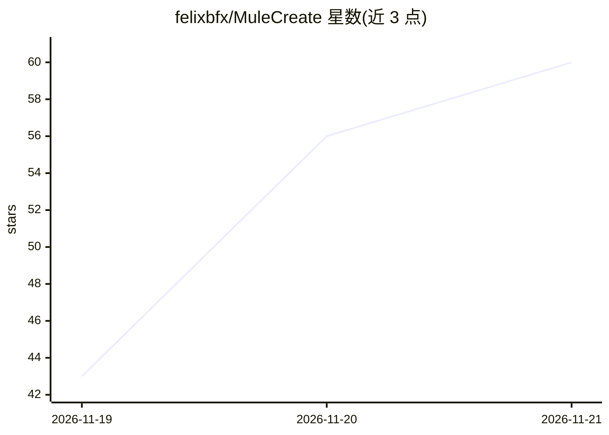

# felixbfx/MuleCreate

⭐ 60 · Python · GPL-3.0 · 推送 2026-11-17 · [GitHub](https://github.com/felixbfx/MuleCreate) · 个人维护

**3D 线稿草图工具，导出简报交 AI 在 Houdini/Blender 重建**

Mule Create 是独立的 3D 技术草图程序：在空间中放置平面并绘制线条，线条可生成曲面、放样与曲线网，支持在图元上附加笔记、参考图与语音反馈。核心工作流是导出 Sketch Brief（含图片、笔记、USD 场景文件与工作规则），由 AI（如 Claude Code 或 Codex）在该文件夹中重建对象；Mule 运行时还提供本地 MCP 服务器供 AI 直接查看场景。Windows 提供免安装包，Linux 从源码运行，macOS 未测试，状态为 Alpha。语音转写使用本地 faster-whisper。

## 筛选速览

| 维度 | 判定 | 备注 |
|---|---|---|
| AI 角色 | `ai-enhanced` | 去掉 AI 部分产品仍成立 |
| 许可风险 | `viral` | GPL-3.0 |
| 部署形态 | `desktop` | 安装包/桌面程序 |
| 模型依赖 | — | README 未给出锁定关系 |
| 硬件要求 | — | 无带数字的原话,不猜 |
| 安装摩擦 | `low` | 无编译、无系统依赖或容器化 |
| 成熟度 | `idea` | |

## 能力要点

- 导出 Sketch Brief（图片/笔记/USD/规则）供 AI 重建模型
- 本地 MCP 服务器（127.0.0.1:8770）供 AI 直接读取场景
- 语音评审转写使用本地 faster-whisper
- 附 AI_HANDBOOK.md 供 AI 助手查询程序用法

## 适用场景

- 概念设计阶段画 3D 线稿，交给 AI 建成 Houdini/Blender 模型
- 在草图上记录笔记和语音反馈，让 AI 理解设计意图
- 通过 USD 与示例场景做设计参考与复用

## 场景标签

 · 领域:3D 设计/概念设计工具

## 证据(README 行号)

> L17: Mule Create (short: Mule) is a standalone program for technical sketching in 3D. You draw lines on planes that you
> L20: pictures, notes, a USD file of the scene and working rules, from which an AI (for example Claude Code or Codex)
> L21: rebuilds the object in Houdini or Blender. While Mule is open, the AI can also look at the scene directly through a

## 星数曲线

2026-11-19 43 → 2026-11-21 60（+17）

---
*卡片 v1 · prompt 1.4 · 生成 2026-11-19 · 置信度 high · 依据 README sha `bc1ec672f5a0` · [字段定义](../../DATASET.md)*
