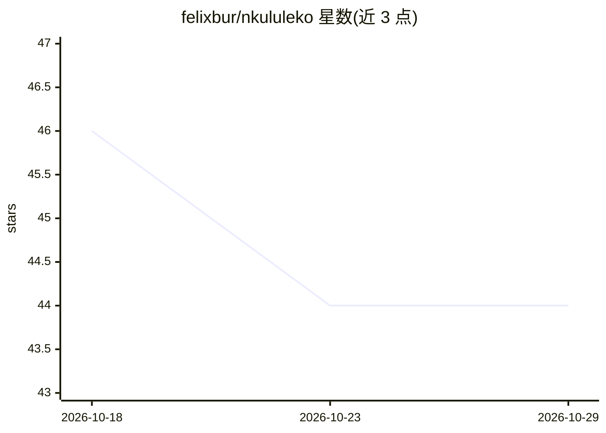

# felixbur/nkululeko

⭐ 44 · Python · MIT · 推送 2026-10-27 · [GitHub](https://github.com/felixbur/nkululeko) · 个人维护

**面向语音说话人特性检测的机器学习实验框架**

基于 sklearn 与 PyTorch 的 Python 框架，通过 ini 配置文件编排数据加载、声学特征提取、模型训练与评估，用于检测语音中的说话人特性如情感、年龄、性别、障碍等。支持多种分类器（SVM、XGBoost、MLP、CNN 等）与特征提取器（Praat、Opensmile、Wav2vec2 等），并提供数据探索、增强、集成学习、元参数优化、偏差检查与不确定性估计等模块。面向语音处理学习者、研究者与机器学习从业者，以 pip 安装，含 Google Colab 示例。

## 筛选速览

| 维度 | 判定 | 备注 |
|---|---|---|
| AI 角色 | `ai-native` | 本体是模型或模型工具 |
| 许可风险 | `permissive` | MIT |
| 部署形态 | `library` | 以包/库形式分发 |
| 模型依赖 | — | README 未给出锁定关系 |
| 硬件要求 | — | 无带数字的原话,不猜 |
| 安装摩擦 | `medium` | 含编译或系统依赖之一 |
| 成熟度 | — | 结构信号不足 |

## 能力要点

- ini 配置文件驱动，从原始音频到训练模型与评估无需直接写 Python 代码
- 多种分类器（SVM/XGBoost/MLP/CNN 等）与特征提取器（Praat/Opensmile/Wav2vec2 等）可组合
- 提供 ensemble、数据增强、元参数优化、VAD 分段、预测等十余个命令行模块
- 支持偏差检查与基于熵的不确定性估计

## 适用场景

- 用情感或年龄等标签数据集训练说话人特性分类模型
- 对比不同特征提取器与分类器的实验效果
- 对音频文件或麦克风输入用已训练模型做预测

## 场景标签

`模型训练` `MLOps` · 领域:训练与推理

## 证据(README 行号)

> L6: Nkululeko is a very common first name from the Zulu and Xhosa languages ​​in South Africa and means "freedom". It is
> L13: Nkululeko is for speech processing learners, researchers and ML practitioners focused on speaker characteristics, e

## 星数曲线

2026-10-18 46 → 2026-10-29 44（-2）

---
*卡片 v1 · prompt 1.4 · 生成 2026-10-25 · 置信度 high · 依据 README sha `c488ef86e1f8` · [字段定义](../../DATASET.md)*
