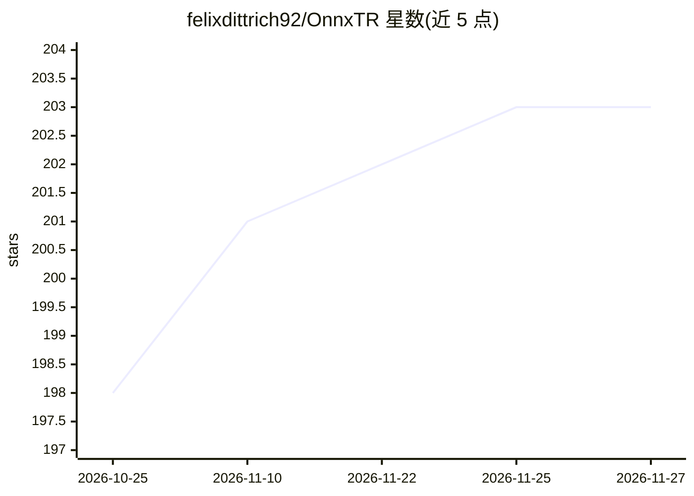

# felixdittrich92/OnnxTR

⭐ 203 · Python · Apache-2.0 · 推送 2026-11-23 · [GitHub](https://github.com/felixdittrich92/OnnxTR) · [官网](https://github.com/mindee/doctr) · 个人维护

**基于 ONNX 的 OCR 推理库，从文档中定位并识别文字**

docTR 库的 ONNX 推理管线封装，不依赖 PyTorch 或 TensorFlow。从 PDF/图片/网页中检测并识别文字，附带版面分析、表格结构识别与 LaTeX 公式识别，结果可导出为 JSON/文本/XML/Markdown 等格式。提供 8-bit 量化模型以降低 CPU 推理开销，支持长文档分块懒加载以控制内存。可通过 CLI 无 Python 代码运行，支持从 HuggingFace Hub 加载或上传自定义模型，文档需 Python 3.11+ 与 pip。

## 筛选速览

| 维度 | 判定 | 备注 |
|---|---|---|
| AI 角色 | `ai-native` | 本体是模型或模型工具 |
| 许可风险 | `permissive` | Apache-2.0 |
| 部署形态 | `library` | 以包/库形式分发 |
| 模型依赖 | local-ok | 支持本地模型 |
| 硬件要求 | — | 无带数字的原话,不猜 |
| 安装摩擦 | `medium` | 含编译或系统依赖之一 |
| 成熟度 | — | 结构信号不足 |

## 能力要点

- 纯 ONNX 推理管线，无 PyTorch/TensorFlow 依赖
- 8-bit 量化模型支持 CPU 推理
- 支持版面分析、表格结构识别与公式转 LaTeX
- 提供 onnxtr-cli 命令行工具与 HuggingFace Hub 模型加载/上传

## 适用场景

- 从 PDF 或扫描图像中批量提取文字
- 文档版面与表格结构解析
- 识别文档中的数学公式并输出 LaTeX
- 资源受限环境下本地运行 OCR

## 场景标签

`OCR` · 领域:感知与多模态

## 证据(README 行号)

> L14: **Optical Character Recognition made seamless & accessible to anyone, powered by Onnx**
> L18: - efficient ways to parse textual information (localize and identify each word) from your documents
> L19: - a Onnx pipeline for docTR, a wrapper around the doctr library - no PyTorch or TensorFlow dependencies

## 星数曲线

2026-10-25 198 → 2026-11-27 203（+5）

---
*卡片 v1 · prompt 1.4 · 生成 2026-11-25 · 置信度 high · 依据 README sha `16759d221977` · [字段定义](../../DATASET.md)*
