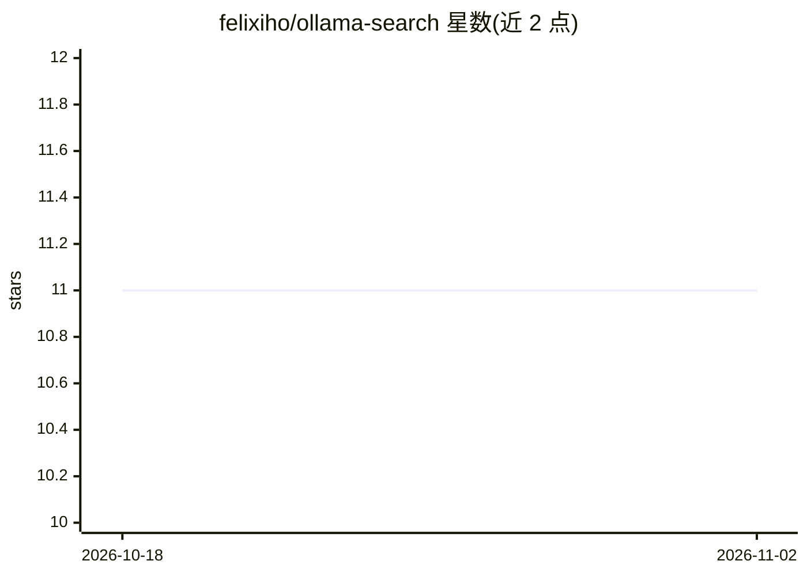

# felixiho/ollama-search

⭐ 11 · TypeScript · 推送 2026-08-28 · [GitHub](https://github.com/felixiho/ollama-search) · 个人维护

**基于本地 Ollama 模型的 AI 搜索引擎网页应用**

开源 Web 应用：用 LangChain 生成搜索查询，经 Tavily API 检索网页，再由本地已安装的 Ollama 模型（llama3、mistral、gemma 等）生成回答，界面基于 React/Next.js 与 Ant Design，支持流式输出。面向希望用自托管 LLM 搭建问答式搜索的用户。前置条件包括本地运行 Ollama、Node.js 18+ 与 Tavily API key；安装方式为 git clone 源码加 pnpm，运行 pnpm dev 启动。

## 筛选速览

| 维度 | 判定 | 备注 |
|---|---|---|
| AI 角色 | `ai-native` | 本体是模型或模型工具 |
| 许可风险 | `none` | — |
| 部署形态 | `library` | 以包/库形式分发 |
| 模型依赖 | local-ok | 支持本地模型 |
| 硬件要求 | — | 无带数字的原话,不猜 |
| 安装摩擦 | `low` | 无编译、无系统依赖或容器化 |
| 成熟度 | — | 结构信号不足 |

## 能力要点

- LangChain 生成搜索查询
- Tavily API 执行网页检索
- 本地 Ollama 模型（llama3/mistral/gemma）生成回答
- React/Next.js 界面，支持流式输出

## 适用场景

- 用自托管 LLM 搭建个人 AI 搜索问答
- 不依赖云端大模型获得带检索的回答
- 在 Next.js 项目基础上定制搜索应用

## 场景标签

`RAG` · 领域:知识与检索

## 证据(README 行号)

> L3: Open-source AI-powered search engine based off Ollama models.
> L9: - 🔍 Generate search queries with langchain
> L11: - 🚀 Answer questions with local installed ollama models (llama3, mistral, gemma)

## 星数曲线

2026-10-18 11 → 2026-11-02 11（+0）

---
*卡片 v1 · prompt 1.4 · 生成 2026-11-02 · 置信度 high · 依据 README sha `80f941e4e4e0` · [字段定义](../../DATASET.md)*
