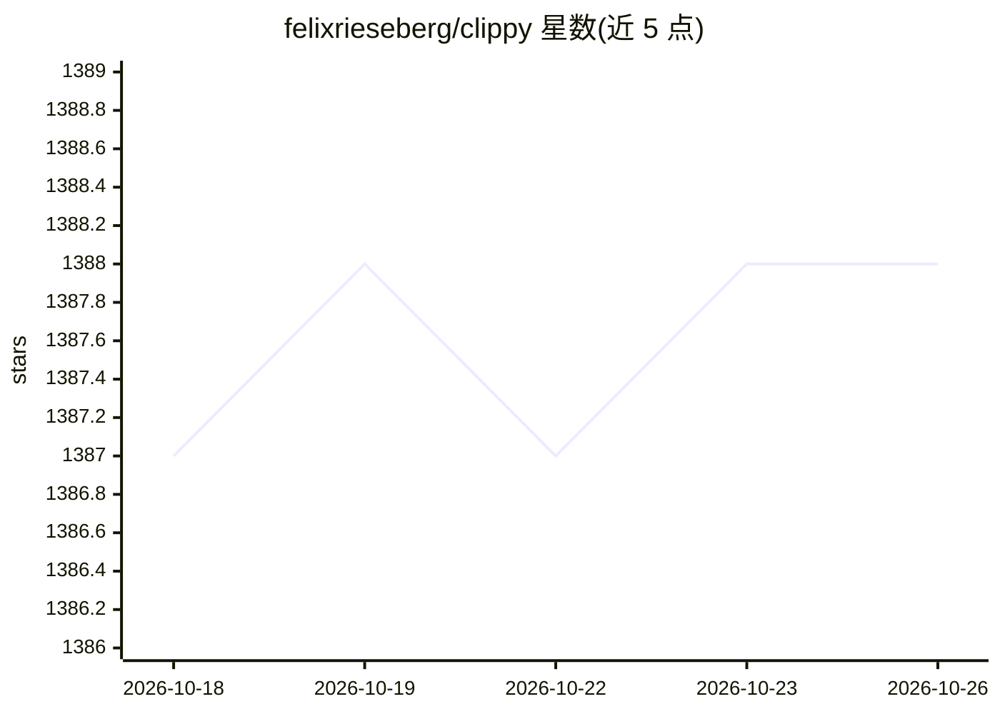

# felixrieseberg/clippy

⭐ 1,388 · TypeScript · NOASSERTION · 推送 2025-11-15 · [GitHub](https://github.com/felixrieseberg/clippy) · [官网](https://felixrieseberg.github.io/clippy/) · 个人维护

**复古 Clippy 风格的本地 LLM 桌面聊天应用**

基于 Electron 的桌面聊天应用，以 1997 年 Microsoft Office 助手 Clippy 的怀旧界面为外壳，通过 llama.cpp 与 node-llama-cpp 在本地运行 GGUF 格式模型，支持一键安装 Gemma3、Llama 3.2、Phi-4、Qwen3。应用自动选择 Metal、CUDA、Vulkan 等高效运行方式，可加载自定义模型并调整提示与参数，全部离线运行，仅更新检查联网（可关闭）。同时作为 @electron/llm 的参考实现。与 Microsoft 无官方关联，作者定位为软件艺术。

## 筛选速览

| 维度 | 判定 | 备注 |
|---|---|---|
| AI 角色 | `ai-native` | 本体是模型或模型工具 |
| 许可风险 | `none` | NOASSERTION |
| 部署形态 | `None` |  |
| 模型依赖 | local-ok | 支持本地模型 |
| 硬件要求 | — | 无带数字的原话,不猜 |
| 安装摩擦 | `medium` | 含编译或系统依赖之一 |
| 成熟度 | — | 结构信号不足 |

## 能力要点

- 通过 llama.cpp 支持 GGUF 格式的多数公开模型
- 一键安装 Gemma3 / Llama 3.2 / Phi-4 / Qwen3
- 自动发现 Metal/CUDA/Vulkan 等高效运行方式
- 完全本地离线运行，作为 @electron/llm 参考实现

## 适用场景

- 在桌面端与本地 LLM 对话，无需配置
- 加载自己下载的 GGUF 模型并调节参数
- Electron 开发者参考如何接入本地语言模型

## 场景标签

`聊天机器人` `AI 助手` · 领域:对话与助手

## 证据(README 行号)

> L3: Clippy let's you run a variety of large language models (LLMs) locally on your computer while sticking with a user i
> L12: - Batteries included: No complicated setup. Just open the app and chat away. Thanks to llama.cpp and `node-llama-cp

## 星数曲线

2026-10-18 1,387 → 2026-10-26 1,388（+1）

---
*卡片 v1 · prompt 1.4 · 生成 2026-10-21 · 置信度 high · 依据 README sha `53d947566db3` · [字段定义](../../DATASET.md)*
