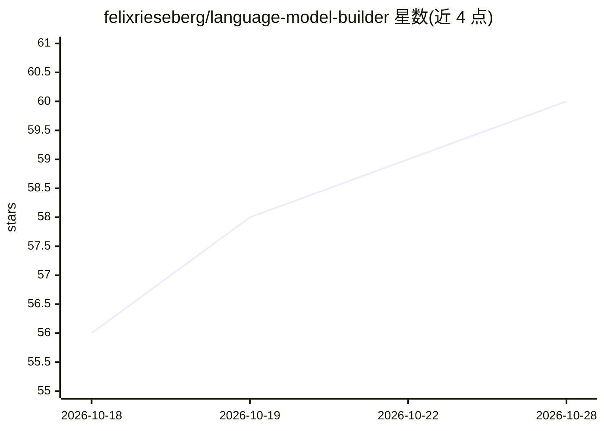

# felixrieseberg/language-model-builder

⭐ 60 · 推送 2026-08-02 · [GitHub](https://github.com/felixrieseberg/language-model-builder) · [官网](https://languagemodelbuilder.com) · 个人维护

**macOS 教学应用：从零构建微型语言模型并与它对话**

面向 Apple silicon Mac 的教育类桌面应用：引导用户在本地从零构建一个小型语言模型，可选择 tokenizer 与训练数据，观看预训练过程中 loss 下降，再训练模型回答问题，最终与自己训练出的模型对话。以官网与 GitHub Releases 分发的已公证（notarized）应用形式提供，要求 macOS 15 及以上，内置 Sparkle 自动更新。

## 筛选速览

| 维度 | 判定 | 备注 |
|---|---|---|
| AI 角色 | `ai-native` | 本体是模型或模型工具 |
| 许可风险 | `none` | — |
| 部署形态 | `None` |  |
| 模型依赖 | — | README 未给出锁定关系 |
| 硬件要求 | — | 无带数字的原话,不猜 |
| 安装摩擦 | `low` | 无编译、无系统依赖或容器化 |
| 成熟度 | — | 结构信号不足 |

## 能力要点

- 在本地从零构建并训练微型语言模型
- 可选择 tokenizer 与训练数据，观看预训练 loss 变化
- 训练后可与模型对话
- 提供已公证的下载包并通过 Sparkle 自更新

## 适用场景

- 通过亲手构建小模型理解语言模型原理
- 在自己的 Mac 上完成训练并对话体验
- 作为 AI 入门教学演示工具

## 场景标签

`教程课程` · 领域:学习与行业

## 证据(README 行号)

> L3: One of the best ways to understand technology, especially when it seems like magic, is to build a small version your
> L11: Requires an Apple silicon Mac running macOS 15 or later. The app updates

## 星数曲线

2026-10-18 56 → 2026-10-28 60（+4）

---
*卡片 v1 · prompt 1.4 · 生成 2026-10-24 · 置信度 high · 依据 README sha `9b73c774217d` · [字段定义](../../DATASET.md)*
