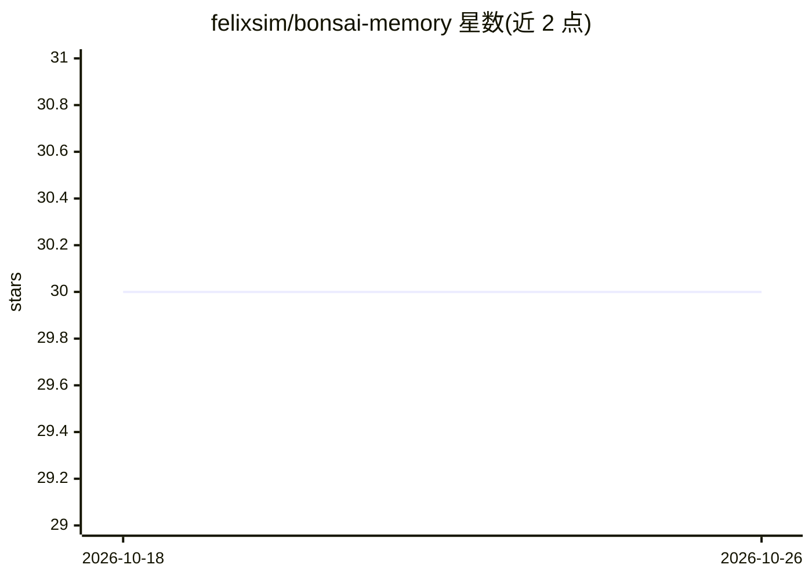

# felixsim/bonsai-memory

⭐ 30 · Shell · MIT · 推送 2026-03-15 · [GitHub](https://github.com/felixsim/bonsai-memory) · 个人维护

**AI agent 持久记忆重构工具：把扁平 MEMORY.md 改为分层树以降低 token**

面向 OpenClaw 及使用文件式持久记忆的 LLM agent 框架的记忆管理技能：把单一 MEMORY.md 按 ## 标题切分，用确定性关键词匹配归类到 9 个领域目录，生成叶子文件与两级索引；启动时仅加载约 300-500 token 的主干索引，按需逐层读取，任意事实查找最多 3 次读取。迁移幂等，原文件备份为 MEMORY.md.bak，删除技能目录即可回滚。零依赖，不需 API key，以 SKILL.md 形式安装。

## 筛选速览

| 维度 | 判定 | 备注 |
|---|---|---|
| AI 角色 | `ai-ecosystem` | LLM/agent 周边工具 |
| 许可风险 | `permissive` | MIT |
| 部署形态 | `None` |  |
| 模型依赖 | — | README 未给出锁定关系 |
| 硬件要求 | — | 无带数字的原话,不猜 |
| 安装摩擦 | `low` | 无编译、无系统依赖或容器化 |
| 成熟度 | — | 结构信号不足 |

## 能力要点

- 扁平 MEMORY.md 重构为 trunk/branch/leaf 三层树，启动仅加载主干索引
- 确定性关键词分类保证迁移幂等，重复运行结果一致
- 与 OpenClaw 的 embedding 语义搜索兼容，提供结构遍历与语义搜索两条检索路径
- 原 MEMORY.md 自动备份，支持回滚

## 适用场景

- 长期运行的 AI agent 记忆膨胀后降低每次会话的 token 开销
- 为多个 agent 分别迁移独立记忆文件
- 希望记忆文件保持 grep 可查、git 可版本管理的用户

## 场景标签

`Agent 记忆` · 领域:Agent 开发

## 证据(README 行号)

> L7: Built for OpenClaw agents. Works with any LLM agent framework that uses persistent memory files.
> L66: LLM agents with persistent memory typically use a flat-file approach: a single `MEMORY.md` (or equivalent) that get
> L229: Works with any AI agent framework that uses file-based persistent memory:

## 星数曲线

2026-10-18 30 → 2026-10-26 30（+0）

---
*卡片 v1 · prompt 1.4 · 生成 2026-10-26 · 置信度 high · 依据 README sha `4361c953cdb0` · [字段定义](../../DATASET.md)*
