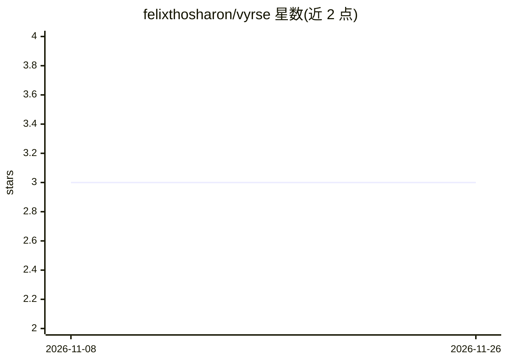

# felixthosharon/vyrse

⭐ 3 · TypeScript · MIT · 推送 2026-11-25 · [GitHub](https://github.com/felixthosharon/vyrse) · 个人维护

**本机运行的语音优先 AI 助手，支持 PC/手机/Echo 控制**

VYRSE 是部署在个人 PC 上的语音优先 AI 助手：唤醒词交互、本地语音合成与识别，可操作 PC（开关应用、找文件、控制音量亮度、截屏解释、浏览网页、提醒事项），并提供 Android 应用通过家庭 Wi-Fi 连回 PC 的同一助手，还能经 Alexa 自定义技能从 Echo 提问。本体制为界面层，模型与工具由 Hermes Agent 引擎承载，本地模型经管理的 llama.cpp 在 GPU 上运行，也可接入 ChatGPT 账号或多家 API key。Windows 10/11 安装包分发，提供源码构建路径。

## 筛选速览

| 维度 | 判定 | 备注 |
|---|---|---|
| AI 角色 | `ai-native` | 本体是模型或模型工具 |
| 许可风险 | `permissive` | MIT |
| 部署形态 | `desktop` | 安装包/桌面程序 |
| 模型依赖 | local-ok | 支持本地模型 |
| 硬件要求 | — | 无带数字的原话,不猜 |
| 安装摩擦 | `medium` | 含编译或系统依赖之一 |
| 成熟度 | — | 结构信号不足 |

## 能力要点

- 唤醒词语音交互，本地语音识别（faster-whisper）与合成（Kokoro）
- PC 控制：应用操作、文件检索、截屏解释、提醒与日程简报
- Android 应用与 Echo/Alexa 可选接入，手机可被 PC 完全操作
- 本地模型经 llama.cpp 在 GPU 运行，支持 .gguf 文件拖入

## 适用场景

- 在个人 PC 上用语音操作电脑和查询信息
- 通过手机或 Echo 在家庭网络内访问自己的助手
- 在本地运行模型并统计相对付费 API 的用量节省

## 场景标签

`AI 助手` `语音 Agent` · 领域:对话与助手

## 证据(README 行号)

> L5: **A voice-first AI assistant that lives on your own PC.** Say "VYRSE" and talk: it answers out loud, runs
> L7: The AI runs locally on your GPU through Hermes Agent:
> L10: > VYRSE is the interface. Hermes Agent is the brain (models, tools, memory, skills, approvals). VYRSE

## 星数曲线

2026-11-08 3 → 2026-11-26 3（+0）

---
*卡片 v1 · prompt 1.4 · 生成 2026-11-22 · 置信度 high · 依据 README sha `23f28de55368` · [字段定义](../../DATASET.md)*
