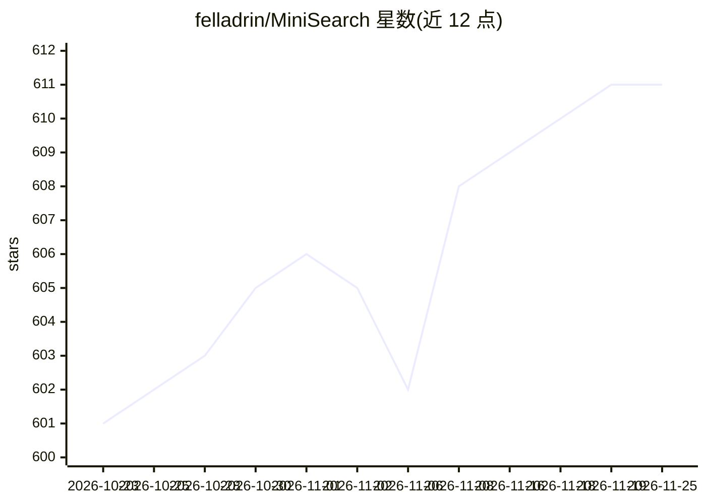

# felladrin/MiniSearch

⭐ 611 · TypeScript · Apache-2.0 · 推送 2026-11-24 · [GitHub](https://github.com/felladrin/MiniSearch) · [官网](https://felladrin-minisearch.hf.space) · 个人维护

**浏览器内运行的私有 AI 搜索引擎，自托管带引用回答**

自托管搜索引擎加 AI 助手：服务器端通过捆绑的 SearXNG 聚合文本与图片搜索结果，用小型 cross-encoder 模型本地重排，浏览器缓存结果；AI 助手读取排序靠前的结果生成带引用的回答，支持追问与对话记忆。AI 模型可完全在浏览器内通过 WebGPU/CPU 运行，无需 API key；也可接入 OpenAI 兼容后端或 AI Horde。整个系统打包为单个 Docker 容器，搜索历史与分析数据留在浏览器本地。

## 筛选速览

| 维度 | 判定 | 备注 |
|---|---|---|
| AI 角色 | `ai-native` | 本体是模型或模型工具 |
| 许可风险 | `permissive` | Apache-2.0 |
| 部署形态 | `self-host` | docker 或自建部署 |
| 模型依赖 | local-ok | 支持本地模型 |
| 硬件要求 | — | 无带数字的原话,不猜 |
| 安装摩擦 | `low` | 无编译、无系统依赖或容器化 |
| 成熟度 | — | 结构信号不足 |

## 能力要点

- AI 模型在浏览器内 WebGPU/CPU 运行，无需 API key，查询不经第三方
- SearXNG 聚合结果经本地 cross-encoder 重排，回答附可验证引用
- 支持 OpenAI 兼容 API 后端与服务器代理 API key 不外泄
- 本地模糊搜索历史、会话恢复与使用统计热力图

## 适用场景

- 搭建不泄露查询记录的私有 AI 搜索入口
- 设为浏览器默认搜索引擎或从 Raycast 触发搜索
- 自托管带引用来源的问答搜索服务

## 场景标签

`AI 助手` `RAG` · 领域:对话与助手

## 证据(README 行号)

> L17: MiniSearch is a self-hosted search engine with an AI assistant.
> L91: Your query goes to the app server, which asks the bundled SearXNG instance to aggregate results from multiple searc

## 星数曲线

2026-10-23 601 → 2026-11-25 611（+10）

---
*卡片 v1 · prompt 1.4 · 生成 2026-11-25 · 置信度 high · 依据 README sha `77f8549632dc` · [字段定义](../../DATASET.md)*
