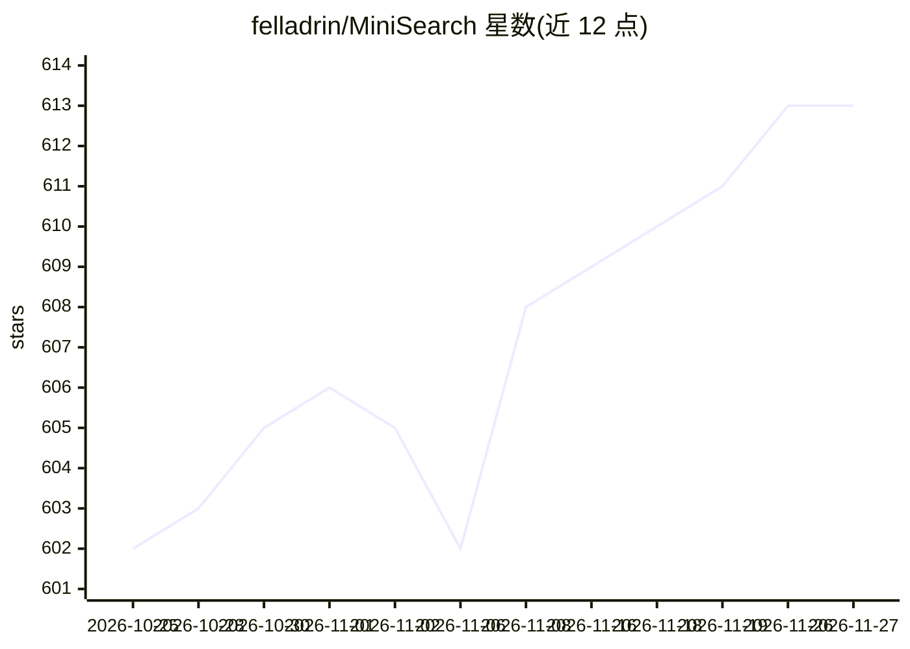

# felladrin/MiniSearch

⭐ 613 · TypeScript · Apache-2.0 · 推送 2026-11-26 · [GitHub](https://github.com/felladrin/MiniSearch) · [官网](https://felladrin-minisearch.hf.space) · 个人维护

**自托管浏览器内运行的隐私 AI 搜索引擎**

自托管的元搜索引擎加 AI 助手，以单个 Docker 容器交付。搜索结果由内置 SearXNG 从多个引擎聚合，服务端用小型 cross-encoder 模型本地重排序；AI 回答由 WebGPU/CPU 上的浏览器内模型生成，或通过 OpenAI 兼容 API、AI Horde、服务器代理 API 等后端提供，回答附带来源引用并支持追问记忆。无 API key 即可运行，历史与缓存存于浏览器本地。安装方式为 Docker 运行/Compose/源码构建，亦可复制 Hugging Face Space 托管。

## 筛选速览

| 维度 | 判定 | 备注 |
|---|---|---|
| AI 角色 | `ai-native` | 本体是模型或模型工具 |
| 许可风险 | `permissive` | Apache-2.0 |
| 部署形态 | `self-host` | docker 或自建部署 |
| 模型依赖 | local-ok | 支持本地模型 |
| 硬件要求 | — | 无带数字的原话,不猜 |
| 安装摩擦 | `low` | 无编译、无系统依赖或容器化 |
| 成熟度 | — | 结构信号不足 |

## 能力要点

- AI 全程在浏览器标签内运行（WebGPU/CPU），无需 API key
- SearXNG 聚合文本与图片结果，服务端 cross-encoder 本地重排序
- 支持 OpenAI 兼容 API 后端及服务器端代理隐藏 API key
- 回答附来源引用、可展示推理过程、支持朗读

## 适用场景

- 搭建不向第三方暴露查询的私有 AI 搜索入口
- 设为浏览器默认搜索引擎或通过 Raycast 触发搜索
- 自托管带引用来源的问答助手
- 嵌入自己的页面提供搜索功能

## 场景标签

`AI 助手` `RAG` `语义搜索` · 领域:对话与助手

## 证据(README 行号)

> L17: MiniSearch is a self-hosted search engine with an AI assistant.
> L19: The AI can run entirely inside your browser tab, on GPU or CPU, so a working setup needs no API key, no separate in
> L24: - **AI in your browser.** Pick from several curated models that run on WebGPU where available and on CPU elsewhere.

## 星数曲线

2026-10-25 602 → 2026-11-27 613（+11）

---
*卡片 v1 · prompt 1.4 · 生成 2026-11-27 · 置信度 high · 依据 README sha `838abfb994f9` · [字段定义](../../DATASET.md)*
