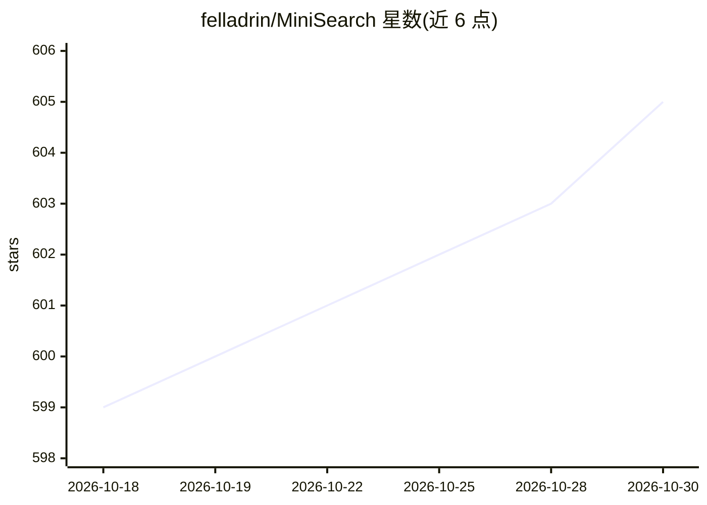

# felladrin/MiniSearch

⭐ 605 · TypeScript · Apache-2.0 · 推送 2026-10-28 · [GitHub](https://github.com/felladrin/MiniSearch) · [官网](https://felladrin-minisearch.hf.space) · 个人维护

**浏览器内运行 AI 的私有自托管搜索引擎，回答带引用**

自托管的元搜索引擎加 AI 助手：Web 结果由内置 SearXNG 聚合、本地交叉编码器重排，AI 模型可在浏览器标签页内以 WebGPU/CPU 运行（135M-4B 参数的精选模型），也可接入 OpenAI 兼容后端（Ollama、LM Studio、vLLM、llama.cpp server 等）、AI Horde 或由服务器代理自有 API key。回答带引用、支持追问与朗读；历史与缓存仅存于浏览器。整体以单个 Docker 容器交付。

## 筛选速览

| 维度 | 判定 | 备注 |
|---|---|---|
| AI 角色 | `ai-native` | 本体是模型或模型工具 |
| 许可风险 | `permissive` | Apache-2.0 |
| 部署形态 | `self-host` | docker 或自建部署 |
| 模型依赖 | local-ok | 支持本地模型 |
| 硬件要求 | — | 无带数字的原话,不猜 |
| 安装摩擦 | `low` | 无编译、无系统依赖或容器化 |
| 成熟度 | — | 结构信号不足 |

## 能力要点

- 模型可直接在浏览器内运行（WebGPU/CPU，135M-4B 参数），无需 API key
- SearXNG 元搜索聚合 + 本地交叉编码器重排
- AI 回答带来源引用，支持追问、展示推理过程与朗读
- 可接入 OpenAI 兼容 API、AI Horde，服务器可代理 key 不暴露

## 适用场景

- 自托管一个不外传查询记录的私人 AI 搜索
- 把它设为浏览器默认搜索引擎或从 Raycast 触发
- 让 AI 基于带引用的搜索结果回答可验证的问题

## 场景标签

`AI 助手` · 领域:对话与助手

## 证据(README 行号)

> L17: MiniSearch is a self-hosted search engine with an AI assistant.
> L19: The AI can run entirely inside your browser tab, on GPU or CPU, so a working setup needs no API key, no separate in
> L27: - **Answers you can verify.** Responses cite the sources they draw from, support follow-up questions with conversat

## 星数曲线

2026-10-18 599 → 2026-10-30 605（+6）

---
*卡片 v1 · prompt 1.4 · 生成 2026-10-21 · 置信度 high · 依据 README sha `742869219541` · [字段定义](../../DATASET.md)*
