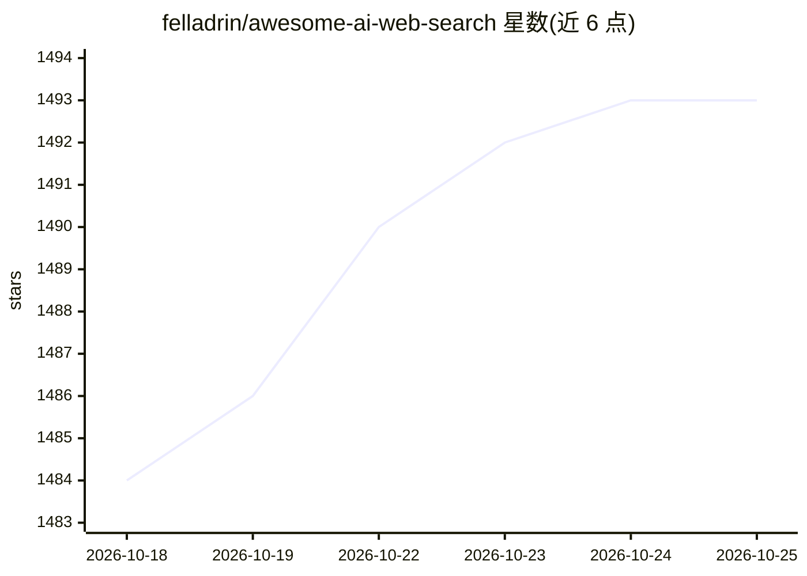

# felladrin/awesome-ai-web-search

⭐ 1,494 · HTML · CC0-1.0 · 推送 2026-10-21 · [GitHub](https://github.com/felladrin/awesome-ai-web-search) · [官网](https://hf.co/spaces/felladrin/awesome-ai-web-search) · 个人维护 · 中文 README

**AI 网络搜索软件策展清单：按时间线收录开源与闭源产品**

由个人维护的 awesome 清单，收录 LLM 与网络搜索结合的软件，按三条时间线组织：开源软件（含首次提交日期与预览链接，2021-2025 共 70 余项）、闭源产品（按上线日期排列，含 Perplexity、Kimi、ChatGPT Search 等）、面向 AI Agent 的网络搜索 API 与 MCP 服务（SearXNG、Tavily、Exa 等）。收录范围限于通用网页搜索，领域专用搜索 API 不在范围内。清单本身托管于 Hugging Face Spaces。

## 筛选速览

| 维度 | 判定 | 备注 |
|---|---|---|
| AI 角色 | `ai-knowledge` | 知识聚合/清单类 |
| 许可风险 | `viral` | CC0-1.0 |
| 部署形态 | `None` |  |
| 模型依赖 | — | README 未给出锁定关系 |
| 硬件要求 | — | 无带数字的原话,不猜 |
| 安装摩擦 | `low` | 无编译、无系统依赖或容器化 |
| 成熟度 | — | 结构信号不足 |

## 能力要点

- 开源/闭源/Agent 工具三类时间线组织，共 170 余条目
- 开源条目附首次提交日期与 Demo/截图等预览链接
- 单独收录可接入 AI Agent 的搜索 API 与 MCP 服务

## 适用场景

- 寻找可自托管的开源 AI 搜索引擎项目
- 了解 AI 网络搜索产品的上线时间线
- 为自建 AI Agent 挑选网页搜索 API

## 场景标签

`精选清单` · 领域:学习与行业

## 证据(README 行号)

> L3: A curated list of AI-powered web search software, focusing on the intersection of Large Language Models (LLMs) and w
> L5: The list is organized as a timeline, containing software that support the following use cases:

## 星数曲线

2026-10-18 1,484 → 2026-10-25 1,493（+9）

---
*卡片 v1 · prompt 1.4 · 生成 2026-10-21 · 置信度 high · 依据 README sha `82f4ce7b2ada` · [字段定义](../../DATASET.md)*
