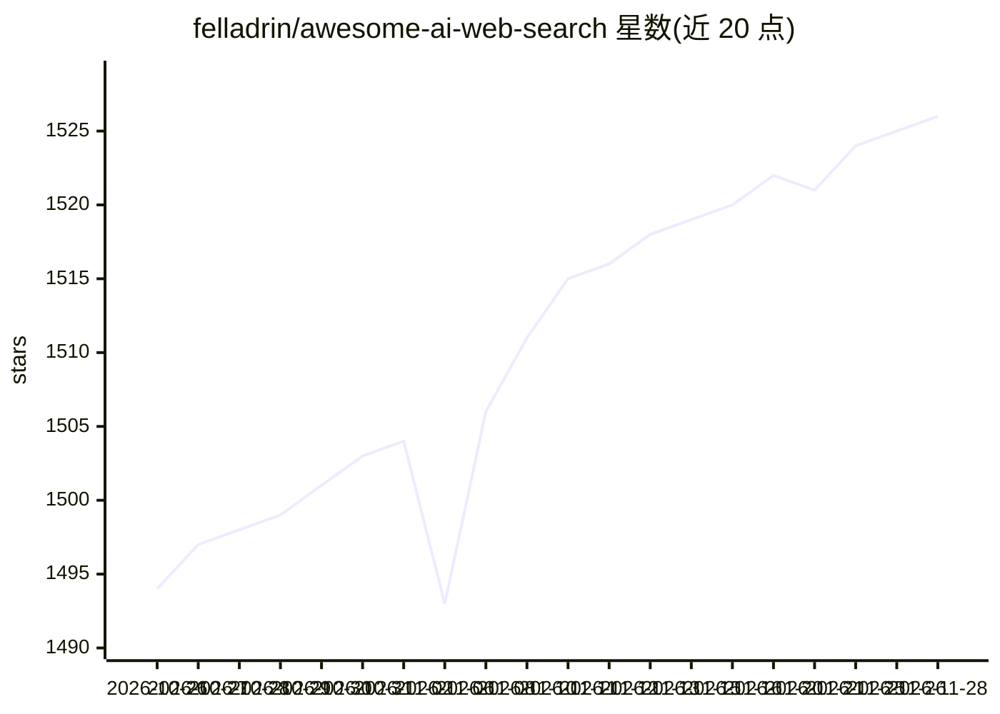

# felladrin/awesome-ai-web-search

⭐ 1,526 · HTML · CC0-1.0 · 推送 2026-11-26 · [GitHub](https://github.com/felladrin/awesome-ai-web-search) · [官网](https://hf.co/spaces/felladrin/awesome-ai-web-search) · 个人维护

**AI 联网搜索软件策展清单：开源/闭源/搜索 API 三类时间线**

一份聚焦 LLM 与网页搜索结合的软件清单，按时间线组织为三个板块：开源终端应用（Khoj、Perplexica、Morphic 等）、闭源商业产品（Perplexity、ChatGPT Search、Kimi 等）、以及供 agent 接入的网页搜索 API/MCP 构件（SerpApi、Tavily、SearXNG 等）。每条条目附提交日期与 Demo/截图链接，仓库自身托管于 Hugging Face Spaces，无安装与运行说明。

## 筛选速览

| 维度 | 判定 | 备注 |
|---|---|---|
| AI 角色 | `ai-knowledge` | 知识聚合/清单类 |
| 许可风险 | `viral` | CC0-1.0 |
| 部署形态 | `None` |  |
| 模型依赖 | — | README 未给出锁定关系 |
| 硬件要求 | — | 无带数字的原话,不猜 |
| 安装摩擦 | `low` | 无编译、无系统依赖或容器化 |
| 成熟度 | — | 结构信号不足 |

## 能力要点

- 开源 AI 搜索软件按初始提交日期排序的时间线表格
- 单独收录闭源商业 AI 搜索产品板块
- 面向 AI agent 的网页搜索 API/MCP 构件清单
- 限定通用网页搜索，域特定搜索（论文/代码/招聘）明确排除

## 适用场景

- 为自建 agent 挑选可接入的网页搜索 API
- 调研 AI 搜索产品的发布时间线与生态
- 寻找可自部署的开源 AI 搜索引擎

## 场景标签

`精选清单` · 领域:学习与行业

## 证据(README 行号)

> L3: A curated list of AI-powered web search software, focusing on the intersection of Large Language Models (LLMs) and w
> L150: Web-search APIs you can wire into your own AI agents by pointing the agent at the API docs, or via an MCP server w

## 星数曲线

2026-10-26 1,494 → 2026-11-28 1,526（+32）

---
*卡片 v1 · prompt 1.4 · 生成 2026-11-27 · 置信度 high · 依据 README sha `47b5b045b6f1` · [字段定义](../../DATASET.md)*
