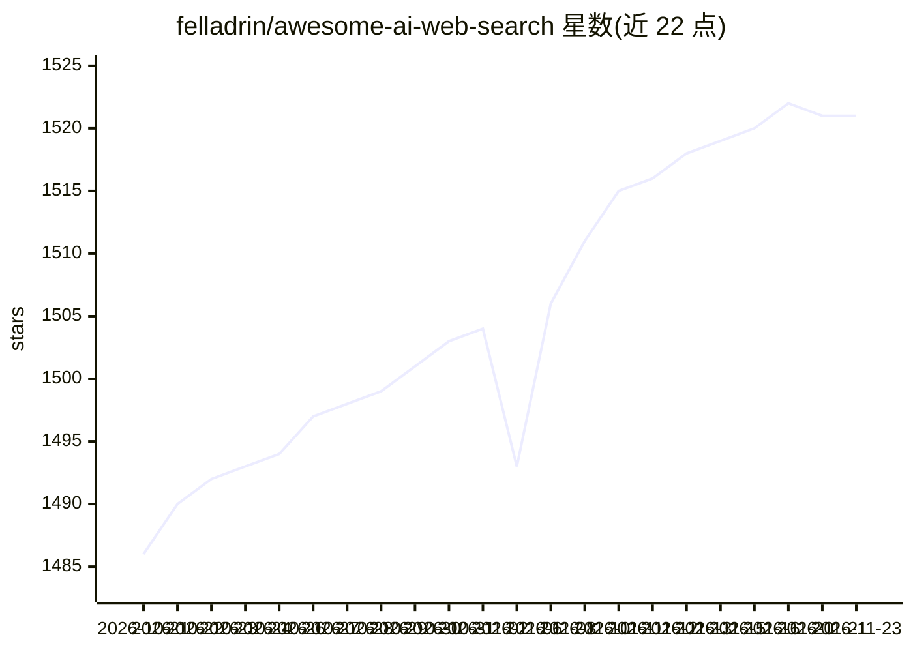

# felladrin/awesome-ai-web-search

⭐ 1,521 · HTML · CC0-1.0 · 推送 2026-11-21 · [GitHub](https://github.com/felladrin/awesome-ai-web-search) · [官网](https://hf.co/spaces/felladrin/awesome-ai-web-search) · 个人维护

**AI 网页搜索软件的策展清单：开源/闭源/搜索 API 三表**

聚焦 LLM 与网页搜索结合的软件清单，按时间线组织为三部分：开源软件（Khoj、Perplexica、Morphic 等约 70 条，附 Demo/截图链接）、闭源服务（Perplexity、Kimi 等约 50 条）、可接入 AI Agent 的网页搜索 API 与 MCP 构件（SearXNG、Tavily、Exa 等），并注明限定通用搜索、排除学术/代码等领域专用搜索。清单托管于 Hugging Face Space。

## 筛选速览

| 维度 | 判定 | 备注 |
|---|---|---|
| AI 角色 | `ai-knowledge` | 知识聚合/清单类 |
| 许可风险 | `viral` | CC0-1.0 |
| 部署形态 | `None` |  |
| 模型依赖 | — | README 未给出锁定关系 |
| 硬件要求 | — | 无带数字的原话,不猜 |
| 安装摩擦 | `low` | 无编译、无系统依赖或容器化 |
| 成熟度 | — | 结构信号不足 |

## 能力要点

- 开源软件时间线表约 70 条，附 Demo/截图/主页链接
- 闭源 AI 搜索服务表约 50 条按上线日期排列
- 面向 AI Agent 的搜索 API/MCP 构件专表
- 声明范围为通用网页搜索，排除领域专用搜索 API

## 适用场景

- 查找支持 LLM 网页搜索的开源软件并直达演示
- 为自建 AI Agent 挑选可接入的网页搜索 API
- 按时间线了解 AI 搜索产品的发展脉络

## 场景标签

`精选清单` · 领域:学习与行业

## 证据(README 行号)

> L3: A curated list of AI-powered web search software, focusing on the intersection of Large Language Models (LLMs) and w
> L5: The list is organized as a timeline, containing software that support the following use cases:
> L146: Web-search APIs you can wire into your own AI agents by pointing the agent at the API docs, or via an MCP server w

## 星数曲线

2026-10-21 1,486 → 2026-11-23 1,521（+35）

---
*卡片 v1 · prompt 1.4 · 生成 2026-11-23 · 置信度 high · 依据 README sha `5e87eb0e2b0a` · [字段定义](../../DATASET.md)*
