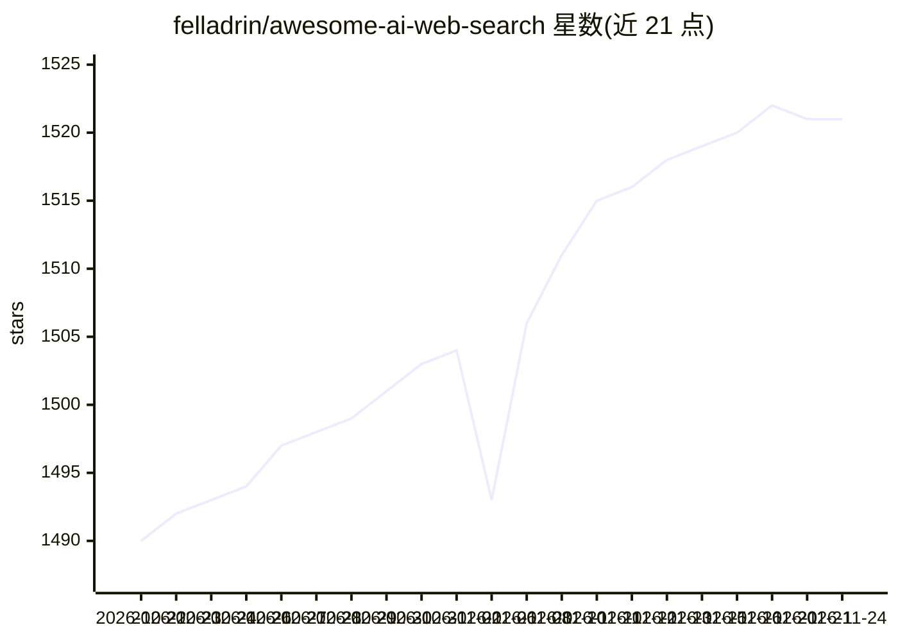

# felladrin/awesome-ai-web-search

⭐ 1,524 · HTML · CC0-1.0 · 推送 2026-11-23 · [GitHub](https://github.com/felladrin/awesome-ai-web-search) · [官网](https://hf.co/spaces/felladrin/awesome-ai-web-search) · 个人维护

**AI 网页搜索软件策展清单：开源/闭源/Agent 搜索 API 分类收录**

以时间线形式收录结合大语言模型与网页搜索能力的软件清单，分三个板块：开源软件（Khoj、Perplexica、GPT Researcher 等 70 余项）、闭源产品（Perplexity、Kimi 等 40 余项）以及可接入自建 AI Agent 的网页搜索 API（SerpApi、SearXNG、Tavily 等）。每条包含发布日期与预览链接，覆盖 LLM 摘要搜索、带网页搜索的聊天、Agent 深度研究报告三类用例，并通过 Hugging Face Space 展示。

## 筛选速览

| 维度 | 判定 | 备注 |
|---|---|---|
| AI 角色 | `ai-knowledge` | 知识聚合/清单类 |
| 许可风险 | `viral` | CC0-1.0 |
| 部署形态 | `None` |  |
| 模型依赖 | — | README 未给出锁定关系 |
| 硬件要求 | — | 无带数字的原话,不猜 |
| 安装摩擦 | `low` | 无编译、无系统依赖或容器化 |
| 成熟度 | — | 结构信号不足 |

## 能力要点

- 开源板块按时间线收录 70+ 项 AI 网页搜索软件
- 闭源板块收录 Perplexity、Kimi 等 40+ 商业产品
- 单独整理可接入 AI Agent 的网页搜索 API 清单
- 通过 Hugging Face Space 在线展示

## 适用场景

- 查找支持网页搜索的开源 LLM 应用
- 为自建 Agent 选择网页搜索 API
- 了解 AI 搜索领域产品的发布脉络

## 场景标签

`精选清单` · 领域:学习与行业

## 证据(README 行号)

> L3: A curated list of AI-powered web search software, focusing on the intersection of Large Language Models (LLMs) and w
> L5: The list is organized as a timeline, containing software that support the following use cases:
> L11: ## Open Source

## 星数曲线

2026-10-22 1,490 → 2026-11-24 1,521（+31）

---
*卡片 v1 · prompt 1.4 · 生成 2026-11-24 · 置信度 high · 依据 README sha `4e2c2d76c3ff` · [字段定义](../../DATASET.md)*
