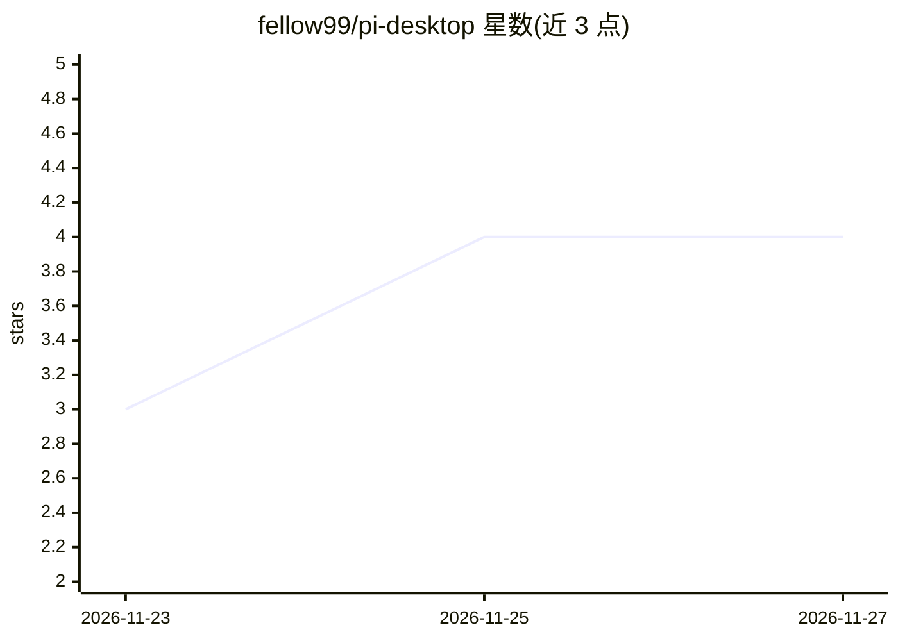

# fellow99/pi-desktop

⭐ — · [GitHub]() · 个人维护 · 中文 README

**把 Pi agent 及其 Web UI 打包为三平台桌面应用的外壳**

非官方的 Electron 桌面外壳，装配上游 pi（可扩展 agent harness）与 pi-web（本地浏览器 UI）：将 pi-web 的 Next 服务器与 agent 以 in-process 方式运行于 Electron 主进程，渲染器同源加载上游 UI（不 fork 前端）。相比「pi CLI + 浏览器」方式，提供托盘、原生通知、单实例、窗口状态记忆、随机端口与自动注入凭据、artifact 首次解压等桌面能力，并按 Windows/macOS/Linux 提供安装包；Windows 已实测，macOS/Linux 构建产物未经运行验证。

## 筛选速览

| 维度 | 判定 | 备注 |
|---|---|---|
| AI 角色 | `ai-ecosystem` | LLM/agent 周边工具 |
| 许可风险 | `permissive` | — |
| 部署形态 | `desktop` | 安装包/桌面程序 |
| 模型依赖 | — | README 未给出锁定关系 |
| 硬件要求 | — | 无带数字的原话,不猜 |
| 安装摩擦 | `low` | 无编译、无系统依赖或容器化 |
| 成熟度 | — | 结构信号不足 |

## 能力要点

- agent 与 Next 服务器以 in-process 运行于 Electron 主进程，启动即可见 Pi 界面
- 随机高位端口 + 自动生成并注入会话凭据，用户不接触登录页
- 托盘、原生通知（会话 JSONL tailing）、单实例召回、窗口状态记忆
- 共享上游 ~/.pi/agent 环境，默认复用已有 pi 配置

## 适用场景

- 想以桌面应用方式使用 pi coding agent，免手动启动服务器和浏览器
- 在 Windows/macOS/Linux 上安装打包好的 Pi Desktop 而非源码运行
- 复用已有 ~/.pi/agent 环境与 API key 继续 agent 会话

## 场景标签

`编码 Agent` · 领域:编码与开发

## 证据(README 行号)

> L22: `Pi` is a minimal, extensible agent harness: extensions, skills, prompt templates and themes are all
> L28: This project puts that stack inside an Electron desktop shell: after launch the user **sees the Pi
> L33: > **Unofficial**: this project is not built by the Pi / Pi Web teams, has no affiliation with the

## 星数曲线

2026-11-23 3 → 2026-11-27 4（+1）

---
*卡片 v1 · prompt 1.4 · 生成 2026-11-23 · 置信度 high · 依据 README sha `da3d60836547` · [字段定义](../../DATASET.md)*
