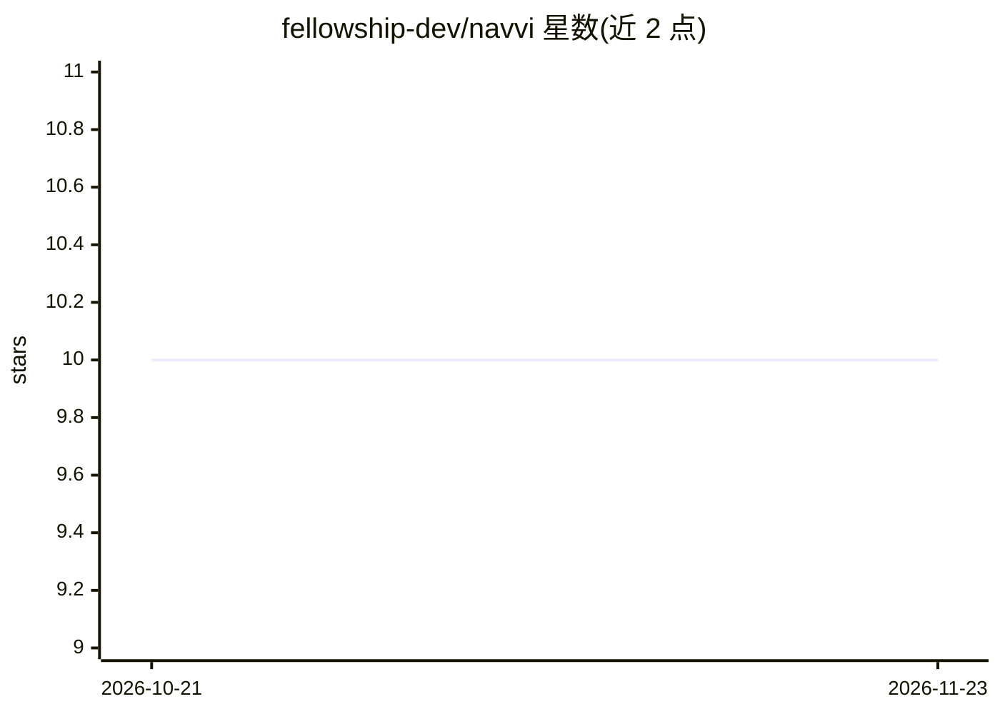

# fellowship-dev/navvi

⭐ 10 · TypeScript · MIT · 推送 2026-10-01 · [GitHub](https://github.com/fellowship-dev/navvi) · [官网](https://fellowship.dev/tools/navvi) · 组织维护

**把浏览器任务编译为可复用爬虫的 CLI**

Navvi 接收自然语言指令与 URL，编译出以选择器和指纹构成的 JSON 爬虫；重放时零 LLM 调用，可在 cron、CI 或 Apify 运行。编译分三层取证：JSON-LD/meta 声明、页面自身 JSON 载荷、DOM 候选元素由模型挑选；字段漂移时自愈重决策，整版重设计报告为 drift 而非猜测。凭据经密封 bundle 管理，不支持验证码求解。以 npm 全局包分发，要求 Node 22+ 与 Playwright Chromium。

## 筛选速览

| 维度 | 判定 | 备注 |
|---|---|---|
| AI 角色 | `ai-native` | 本体是模型或模型工具 |
| 许可风险 | `permissive` | MIT |
| 部署形态 | `library` | 以包/库形式分发 |
| 模型依赖 | — | README 未给出锁定关系 |
| 硬件要求 | — | 无带数字的原话,不猜 |
| 安装摩擦 | `low` | 无编译、无系统依赖或容器化 |
| 成熟度 | — | 结构信号不足 |

## 能力要点

- 编译后的爬虫为 JSON 文件，重放零 LLM 调用
- 三层取证流水线：声明数据→页面 JSON 载荷→DOM 候选
- 字段漂移自愈，重设计报告为 drift
- 多种 decider/writer 后端（Jev、Claude Code、Codex、API key、本地 agent stdio）

## 适用场景

- 把一次性抓取任务变成可长期定时运行的数据管道
- 让编码代理按 SKILL.md 调用 navvi 代替手写 Playwright 脚本
- 网站改版后自动修复或上报失效的爬虫
- 在 Apify 上托管带凭据重放的无人值守抓取

## 场景标签

`网页抓取` `浏览器自动化` · 领域:效率与自动化

## 证据(README 行号)

> L13: - **Your agent asks in plain words.** `navvi "extract the title, price and availability" <url>`.
> L17: - **Re-runs make zero LLM calls.** The compiled scraper is a JSON file of selectors
> L143: 3. **Tier 3 — the DOM.** Code enumerates candidate elements; the chooser picks one

## 星数曲线

2026-10-21 10 → 2026-11-23 10（+0）

---
*卡片 v1 · prompt 1.4 · 生成 2026-11-19 · 置信度 high · 依据 README sha `db369fe140c3` · [字段定义](../../DATASET.md)*
