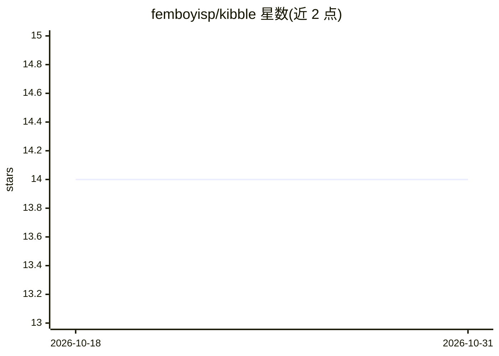

# femboyisp/kibble

⭐ 14 · Rust · Apache-2.0 · 推送 2026-08-18 · [GitHub](https://github.com/femboyisp/kibble) · 个人维护

**Rust 数据摄取与清洗工具：把任意来源加工成微调数据集和知识库**

用 Rust 编写的命令行数据摄取与处理工具：从本地文件、git 仓库、网站、HuggingFace 数据集、网盘分享链接等来源拉取内容，经 OCR/转录/清洗、去重与防泄漏切分后构建 chat 格式 JSONL 数据集，供训练与检索使用。核心流程（clean/index/search/build/eval/pack/crawl）可完全离线运行，语义功能（embed/cluster/ask）依赖可选的 OpenAI 兼容后端且失败可降级到 BM25。附带 eval 质量门禁（CI 可用）、HTTP 摄取服务、MCP 工具暴露与 agent 技能（SKILL.md）安装注册。

## 筛选速览

| 维度 | 判定 | 备注 |
|---|---|---|
| AI 角色 | `ai-ecosystem` | LLM/agent 周边工具 |
| 许可风险 | `permissive` | Apache-2.0 |
| 部署形态 | `library` | 以包/库形式分发 |
| 模型依赖 | — | README 未给出锁定关系 |
| 硬件要求 | — | 无带数字的原话,不猜 |
| 安装摩擦 | `high` | 编译与系统依赖俱全 |
| 成熟度 | — | 结构信号不足 |

## 能力要点

- fetch→build→tune→pack→train→eval 全流程命令，构建 chat 格式数据集
- 按 SHA256(answer) 切分使 train/valid/test 精确泄漏不可能，可选 MinHash 近重复清理
- eval 输出 0-100 评分与 report.{json,md}，--strict 可阻塞 CI
- 核心流程完全离线，embed/LLM 后端可选且 fail-soft 降级到 BM25
- 以 MCP 工具（stdio JSON-RPC）暴露整套工具链，支持 SKILL.md 技能安装（仅复制注册不执行）

## 适用场景

- 把散落各处的语料（仓库、网页、网盘、数据集）加工成微调数据集
- 在 CI 中对数据集做质量与泄漏门禁检查
- 为 bot/自动化提供 HTTP 摄取端点，提交链接即入库
- 构建 BM25+语义混合检索的本地知识索引

## 场景标签

`RAG` `文档解析` · 领域:知识与检索

## 证据(README 行号)

> L16: `kibble` acquires knowledge and data at scale from almost anywhere (local files, git repos,
> L18: catalogs it, and builds chat-format JSONL datasets — the raw material for training and retrieval.
> L22: The heavy lifting (model training, OCR, embeddings) lives in external backends; `kibble` is the

## 星数曲线

2026-10-18 14 → 2026-10-31 14（+0）

---
*卡片 v1 · prompt 1.4 · 生成 2026-10-31 · 置信度 high · 依据 README sha `6e5444d0a48c` · [字段定义](../../DATASET.md)*
