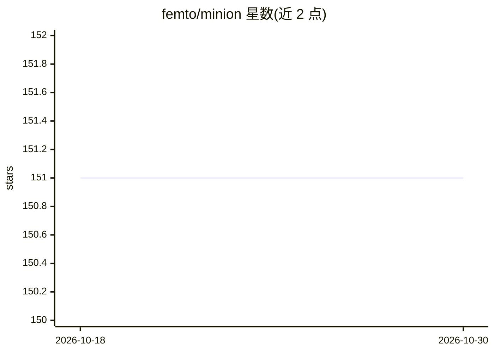

# femto/minion

⭐ 151 · Python · MIT · 推送 2026-10-08 · [GitHub](https://github.com/femto/minion) · 组织维护 · 中文 README

**Python agent 框架：通过代码执行与多模型接入处理各类查询**

Minion 是一个 Python agent 框架，核心组件包括 CodeAgent（支持工具调用的 Python 代码执行 agent）与 Brain（brain.step() 接口）。工作流程为：接收查询→生成解决方案→验证→不满意则改进重试，直至输出结果。提供自动上下文压缩（Auto-compact）、大工具响应管理（Auto-decay）、工具搜索（TST）、模块化 Skills 与 MCP 工具集成。支持 OpenAI、Azure、Bedrock、Anthropic 及 LiteLLM（100+ 提供商，含 Ollama/vLLM 等本地运行时）多后端接入。通过 PyPI（minionx）、源码安装或 Docker 提供，配置采用 YAML + 环境变量。

## 筛选速览

| 维度 | 判定 | 备注 |
|---|---|---|
| AI 角色 | `ai-ecosystem` | LLM/agent 周边工具 |
| 许可风险 | `permissive` | MIT |
| 部署形态 | `library` | 以包/库形式分发 |
| 模型依赖 | local-ok | 支持本地模型 |
| 硬件要求 | — | 无带数字的原话,不猜 |
| 安装摩擦 | `low` | 无编译、无系统依赖或容器化 |
| 成熟度 | `idea` | |

## 能力要点

- CodeAgent：支持工具调用的 Python 代码执行 agent
- 查询→生成→验证→改进的自迭代工作流
- 多提供商支持：OpenAI、Azure、Bedrock、Anthropic、LiteLLM（100+）
- Auto-compact / Auto-decay 自动上下文管理，TST 动态工具发现

## 适用场景

- 构建能执行 Python 代码并调用工具的 agent 应用
- 通过 brain.step() 处理数学、推理等查询任务
- 在同一框架内切换 OpenAI、Azure、Bedrock 及本地模型后端

## 场景标签

`Agent 框架` · 领域:Agent 开发

## 证据(README 行号)

> L11: High performance agent framework that can do everything. Minion is designed to execute any type of queries, offerin
> L21: - **Multi-provider Support** - OpenAI, Azure, Bedrock, Anthropic, LiteLLM (100+ providers)
> L79: from minion.agents.code_agent import CodeAgent

## 星数曲线

2026-10-18 151 → 2026-10-30 151（+0）

---
*卡片 v1 · prompt 1.4 · 生成 2026-10-22 · 置信度 high · 依据 README sha `b612fcc94ec8` · [字段定义](../../DATASET.md)*
