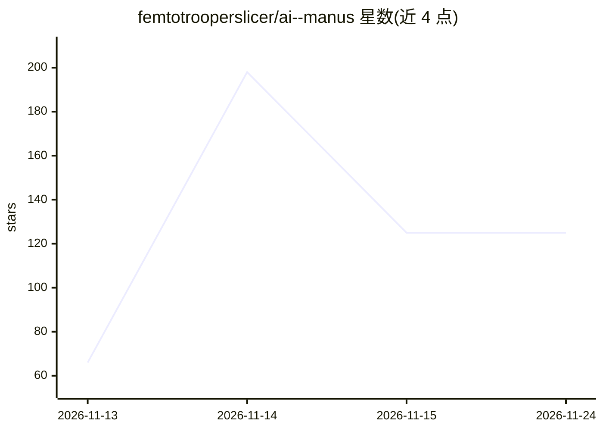

# femtotrooperslicer/ai--manus

⭐ 125 · Apache-2.0 · 推送 2026-11-15 · [GitHub](https://github.com/femtotrooperslicer/ai--manus) · 组织维护

**面向个人用户的自主 AI Agent：自动执行代码与浏览器操作**

Manus 是一个面向家庭、学习与轻量办公场景的自主 AI Agent，用户以自然语言下达指令，代理自行编写并执行脚本、控制浏览器（打开网页、填写表单、抓取信息），完成多步骤任务，需少量监督。代理可在后台待命、跨会话复用工作流模式。README 给出兼容性表（最低双核 CPU、4GB 内存）与使用步骤说明，但未提供任何具体的安装命令、模型接入方式或代码仓库结构信息，仅以『Download Manus』指向获取途径。

## 筛选速览

| 维度 | 判定 | 备注 |
|---|---|---|
| AI 角色 | `ai-native` | 本体是模型或模型工具 |
| 许可风险 | `permissive` | Apache-2.0 |
| 部署形态 | `None` |  |
| 模型依赖 | — | README 未给出锁定关系 |
| 硬件要求 | — | 无带数字的原话,不猜 |
| 安装摩擦 | `low` | 无编译、无系统依赖或容器化 |
| 成熟度 | — | 结构信号不足 |

## 能力要点

- 自主编写并执行代码脚本完成任务
- 浏览器控制：导航网页、填写表单、收集信息
- 代码与浏览器操作可在同一工作流中衔接
- 面向小规模场景：学习、家庭项目、轻量办公

## 适用场景

- 让代理替我跑小脚本、查网页、汇总信息
- 远程或学习中把重复性小任务委托给后台代理
- 不需要编程基础也能完成多步骤自动化任务

## 场景标签

`AI 助手` `浏览器自动化` `编码 Agent` · 领域:效率与自动化

## 证据(README 行号)

> L10: - **Autonomous Code Execution:** Manus AI agent runs code on its own to complete tasks, so you can focus on decisio
> L18: Manus is an autonomous AI agent designed to run code and control a browser on your behalf. Instead of acting like a

## 星数曲线

2026-11-13 66 → 2026-11-24 125（+59）

---
*卡片 v1 · prompt 1.4 · 生成 2026-11-17 · 置信度 mid · 依据 README sha `a3d88e202bf0` · [字段定义](../../DATASET.md)*
