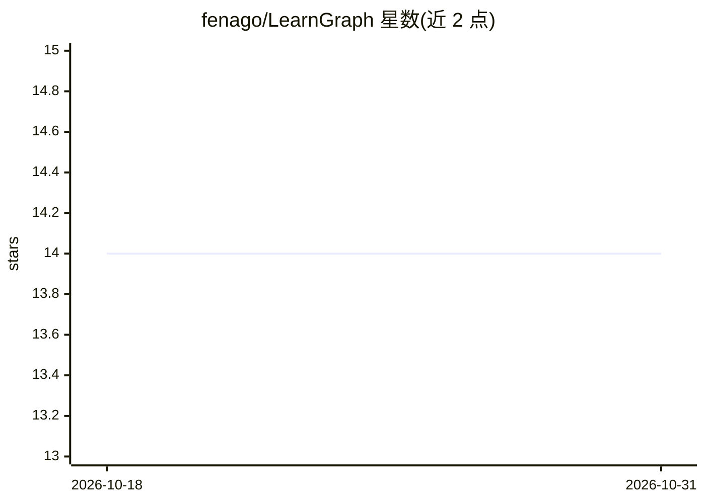

# fenago/LearnGraph

⭐ 14 · TypeScript · 推送 2025-12-14 · [GitHub](https://github.com/fenago/LearnGraph) · 个人维护

**给任意 LLM 提供学习者画像与知识图谱的个性化教育知识库**

基于 LevelDB 与 Next.js 的 Graph RAG 知识库系统：存储学习者的 39 个心理测量维度画像、知识掌握度与误解记录，以及带先修关系、Bloom 分类的概念图谱；基于 ZPD 生成“接下来学什么”推荐、知识缺口检测、Ebbinghaus/SM-2 间隔重复排程与补救计划，并通过 REST API 与 Admin UI 提供完整 CRUD 与交互式图谱可视化。面向希望让任意 LLM 获得特定学习者上下文的开发者；注意 LLM 提示增强（RAG Context Generation）仍处于 Planned 阶段，当前交付的是知识库与推荐层。

## 筛选速览

| 维度 | 判定 | 备注 |
|---|---|---|
| AI 角色 | `ai-ecosystem` | LLM/agent 周边工具 |
| 许可风险 | `none` | — |
| 部署形态 | `None` |  |
| 模型依赖 | — | README 未给出锁定关系 |
| 硬件要求 | — | 无带数字的原话,不猜 |
| 安装摩擦 | `low` | 无编译、无系统依赖或容器化 |
| 成熟度 | — | 结构信号不足 |

## 能力要点

- 39 个心理测量维度的学习者画像（支持自动推断/手动/测评四种录入模式）
- ZPD 推荐、知识缺口检测与 SM-2 间隔重复排程
- 先修关系概念图谱 + 掌握度着色的交互式可视化（React Flow）
- REST API 覆盖学习者/概念/边/状态/推荐/缺口/排程等操作

## 适用场景

- 为教育类 LLM 应用提供每个学习者的个性化上下文
- 管理课程概念图谱并诊断学生的知识缺口
- 按遗忘曲线安排复习计划与补救学习路径

## 场景标签

`知识图谱` `知识库管理` · 领域:知识与检索

## 证据(README 行号)

> L20: LearnGraph is a **Graph RAG (Retrieval-Augmented Generation) knowledge base** that enables personalized education b
> L42: |**RAG Context Generation**|Augment LLM prompts with learner context|Planned (Phase 7)|
> L323: |Phase 7|RAG Integration with LLMs|Planned|

## 星数曲线

2026-10-18 14 → 2026-10-31 14（+0）

---
*卡片 v1 · prompt 1.4 · 生成 2026-10-31 · 置信度 high · 依据 README sha `a44bcf33ce5e` · [字段定义](../../DATASET.md)*
