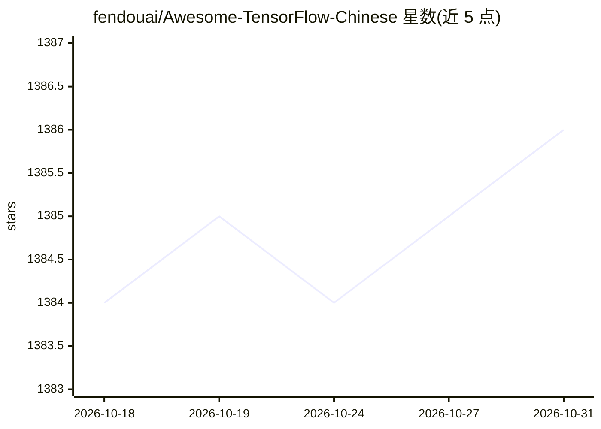

# fendouai/Awesome-TensorFlow-Chinese

⭐ 1,386 · Python · Apache-2.0 · 推送 2026-07-28 · [GitHub](https://github.com/fendouai/Awesome-TensorFlow-Chinese) · [官网](http://panchuang.net/) · 个人维护 · 中文 README

**TensorFlow 中文学习资源精选清单：教程/项目/书籍/论文聚合**

面向中文用户的 TensorFlow 学习资源 awesome 清单：按学习路径组织，收录官方网站与中文镜像链接、安装教程（Mac/Ubuntu/Windows 官方与中文教程）、入门教程、模型项目与基于 TensorFlow 的产品、第三方库、视频课程、论文、官方博客与社区群组（QQ 群/微信群）。内容参考英文项目 jtoy/awesome-tensorflow 编译，附 TensorFlow 中文社区站点链接。仅做资源编目，不含可安装的代码。

## 筛选速览

| 维度 | 判定 | 备注 |
|---|---|---|
| AI 角色 | `ai-knowledge` | 知识聚合/清单类 |
| 许可风险 | `permissive` | Apache-2.0 |
| 部署形态 | `None` |  |
| 模型依赖 | — | README 未给出锁定关系 |
| 硬件要求 | — | 无带数字的原话,不猜 |
| 安装摩擦 | `low` | 无编译、无系统依赖或容器化 |
| 成熟度 | — | 结构信号不足 |

## 能力要点

- 按学习路径组织的中文资源分类（官网/安装/入门/实战）
- 收录大量 TensorFlow 论文实现与模型项目链接
- 覆盖教程、书籍、视频、论文、博客等多类型资源
- 附 QQ/微信中文社区入口与 TensorFlow 中文社区站点

## 适用场景

- 中文用户寻找 TensorFlow 入门与安装教程
- 查找 TensorFlow 论文实现与实战项目列表
- 了解 TensorFlow 相关书籍、视频与社区资源

## 场景标签

`精选清单` · 领域:学习与行业

## 证据(README 行号)

> L1: # Awesome-TensorFlow-Chinese
> L3: TensorFlow 中文资源全集，学习路径推荐：
> L16: 很多内容参考下面这个英文项目，收集了中文资源:

## 星数曲线

2026-10-18 1,384 → 2026-10-31 1,386（+2）

---
*卡片 v1 · prompt 1.4 · 生成 2026-10-21 · 置信度 high · 依据 README sha `3185da33352a` · [字段定义](../../DATASET.md)*
