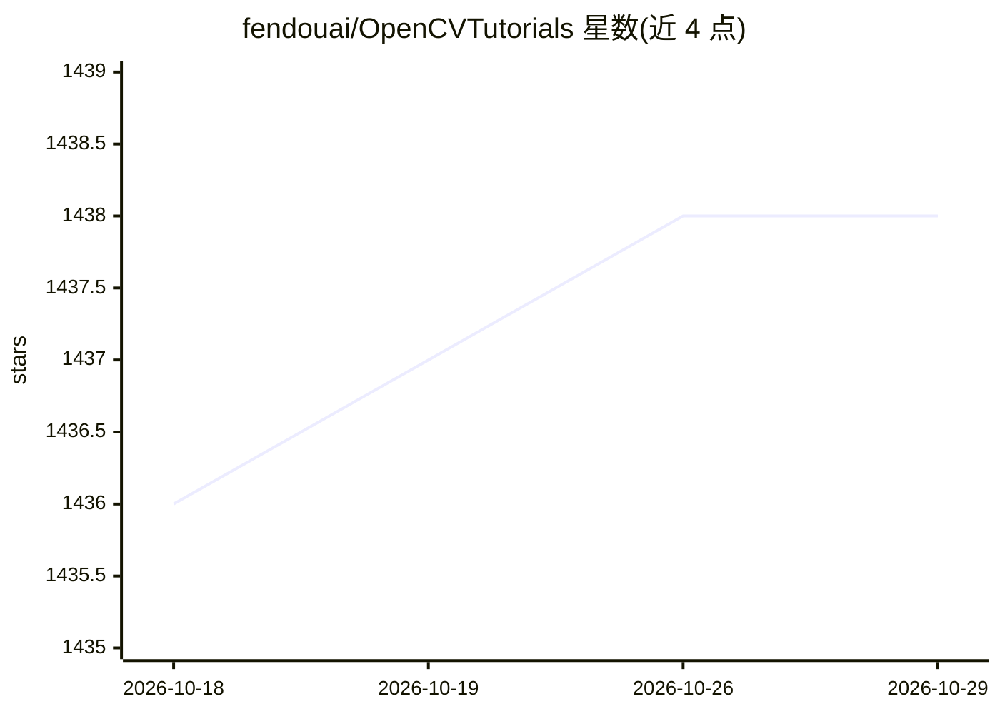

# fendouai/OpenCVTutorials

⭐ 1,438 · Python · Apache-2.0 · 推送 2026-07-28 · [GitHub](https://github.com/fendouai/OpenCVTutorials) · [官网](http://woshicver.com/) · 个人维护 · 中文 README

**OpenCV-Python 4.1 官方教程的中文翻译文档**

将 OpenCV 官方 OpenCV-Python Tutorials（4.1.2 版本）翻译为中文的文档仓库，内容覆盖 OpenCV 安装、GUI 特性、图像处理、特征检测、视频分析、相机校准与 3D 重建、机器学习（KNN/SVM/K 均值）、计算摄影学与目标检测等章节。因段力辉 2014 年翻译的 3.0 版内容已过时，本项目针对 4.1 版更新重新翻译，面向中文初学者学习 OpenCV-Python 使用，另有在线站点 woshicver.com。

## 筛选速览

| 维度 | 判定 | 备注 |
|---|---|---|
| AI 角色 | `ai-knowledge` | 知识聚合/清单类 |
| 许可风险 | `permissive` | Apache-2.0 |
| 部署形态 | `None` |  |
| 模型依赖 | — | README 未给出锁定关系 |
| 硬件要求 | — | 无带数字的原话,不猜 |
| 安装摩擦 | `low` | 无编译、无系统依赖或容器化 |
| 成熟度 | — | 结构信号不足 |

## 能力要点

- 对应 OpenCV 4.1.2 官方教程的完整中文翻译
- 覆盖安装、图像处理、特征检测、视频分析、机器学习、目标检测等章节
- 提供在线阅读站点 woshicver.com

## 适用场景

- 中文环境下按章节学习 OpenCV-Python 官方教程
- 查阅 4.1 版函数用法与各算法示例
- 对比 3.0 旧版翻译，跟进 4.1 更新内容

## 场景标签

`教程课程` · 领域:学习与行业

## 证据(README 行号)

> L5: **OpenCV-Python Tutorials**是官方提供的文档，其内容全面、简单易懂，使得初学者能够快速上手使用。2014年段力辉在当时已翻译过OpenCV3.0，但时隔五年，如今的**OpenCV4.1**中许多函数和内容
> L9: OpenCV-Python Tutorials官方文档：https://docs.opencv.org/4.1.2/d6/d00/tutorial_py_root.html

## 星数曲线

2026-10-18 1,436 → 2026-10-29 1,438（+2）

---
*卡片 v1 · prompt 1.4 · 生成 2026-10-21 · 置信度 high · 依据 README sha `9643d95a099c` · [字段定义](../../DATASET.md)*
