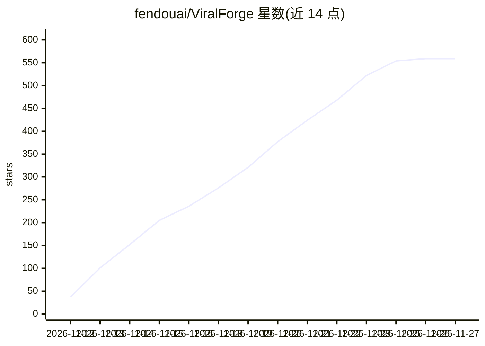

# fendouai/ViralForge

⭐ 559 · TypeScript · Apache-2.0 · 推送 2026-11-23 · [GitHub](https://github.com/fendouai/ViralForge) · [官网](https://wearai.net/ai-video-generator) · 组织维护 · 中文 README

**面向增长团队：解构爆款短视频脚本并生成可编辑复刻项目**

输入爆款视频链接或本地文件，输出 Viral DNA 报告，解构 hook、分镜结构、词锚点、节拍网格、字幕风格、情绪曲线与转化逻辑；替换产品与脚本后一键重建为可编辑的 VFML 项目，并生成 10 个带成本的变体用于 A/B 测试。通过 Skill、MCP server 与 CLI 暴露给 agent 调用，附带 Node studio（npm run dev）与三个案例档案；README 中演示视频为 Jimeng 手动生成，非自动化的模型调用。

## 筛选速览

| 维度 | 判定 | 备注 |
|---|---|---|
| AI 角色 | `ai-native` | 本体是模型或模型工具 |
| 许可风险 | `permissive` | Apache-2.0 |
| 部署形态 | `library` | 以包/库形式分发 |
| 模型依赖 | — | README 未给出锁定关系 |
| 硬件要求 | — | 无带数字的原话,不猜 |
| 安装摩擦 | `medium` | 含编译或系统依赖之一 |
| 成熟度 | — | 结构信号不足 |

## 能力要点

- Viral DNA 报告解构 hook、节拍、词锚点与可迁移公式
- 一键重建为可编辑 VFML 项目并生成 10 个带成本变体
- Skill + MCP + CLI 使整个流程可被 agent 调用
- v0.1 studio 内置中文 demo fixtures，文档英文为主

## 适用场景

- 把竞品爆款视频的结构复用到自己的产品上
- 批量产出脚本变体做 UGC 广告 A/B 测试
- 增长团队沉淀可共享的视频拆解资产
- agent builder 通过 MCP/CLI 接入视频工作流

## 场景标签

`AI 写作` · 领域:内容生成

## 证据(README 行号)

> L21: **ViralForge is an agent-native studio for viral short videos.** Paste a link or a local file and
> L101: |Agent-callable|Rarely|No|**Skill + MCP + CLI**|
> L104: **Built for:** growth teams, UGC agencies, e-commerce brands, solo founders, and agent builders who

## 星数曲线

2026-11-12 37 → 2026-11-27 559（+522）

---
*卡片 v1 · prompt 1.4 · 生成 2026-11-25 · 置信度 mid · 依据 README sha `6015604dee97` · [字段定义](../../DATASET.md)*
