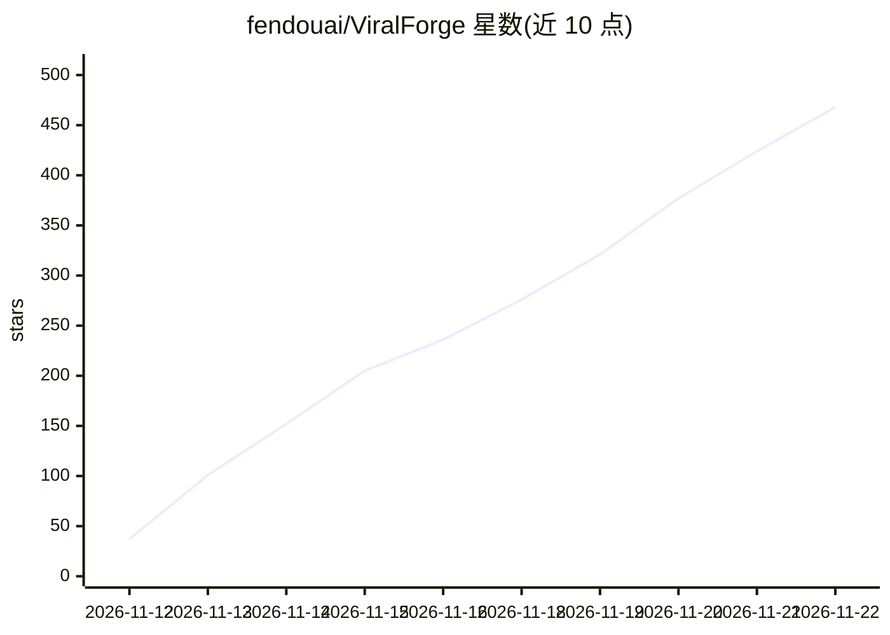

# fendouai/ViralForge

⭐ 468 · TypeScript · Apache-2.0 · 推送 2026-11-20 · [GitHub](https://github.com/fendouai/ViralForge) · 个人维护 · 中文 README

**爆款短视频一键复刻工作室：拆解脚本结构并产出10个变体**

输入爆款短视频链接或本地文件，生成 Viral DNA 报告（钩子、逐镜结构、词锚点、节拍、字幕风格、情绪曲线与转化逻辑），替换产品和文案后一键重建为可编辑的 VFML 项目，并生成 10 个带成本估算的 A/B 变体。整个工作室以 agent 工具链形式提供：Skill 工作流规则、MCP 服务器（list_cases/get_case/analyze_video/build_project）、本地 CLI 与机器可读产物（dna.json、project.vfml.json、变体 CSV、成本台账）。面向增长团队、UGC 机构、电商品牌与独立创始人。v0.1 工作室附带中文演示样例，文档与 agent 界面以英文为主。

## 筛选速览

| 维度 | 判定 | 备注 |
|---|---|---|
| AI 角色 | `ai-native` | 本体是模型或模型工具 |
| 许可风险 | `permissive` | Apache-2.0 |
| 部署形态 | `library` | 以包/库形式分发 |
| 模型依赖 | — | README 未给出锁定关系 |
| 硬件要求 | — | 无带数字的原话,不猜 |
| 安装摩擦 | `medium` | 含编译或系统依赖之一 |
| 成熟度 | — | 结构信号不足 |

## 能力要点

- Viral DNA 报告拆解钩子、逐镜结构、词锚点与可迁移公式
- 一键重建为可编辑 VFML 项目并生成 10 个带成本估算的变体
- Skill + MCP + CLI 三层 agent 调用面，产物均为机器可读 JSON/CSV
- 本地确定性分析（analyze/report/render CLI），无浏览器自动化

## 适用场景

- 拆解爆款短视频脚本，沉淀可复用的结构与钩子公式
- 为自有产品快速生成结构和风格一致的复刻视频与 A/B 变体
- 让 Claude Code/Cursor 等 agent 通过 MCP 调用完整的视频复刻工作流

## 场景标签

`AI 写作` · 领域:内容生成

## 证据(README 行号)

> L19: **ViralForge is an agent-native studio for viral short videos.** Paste a link or a local file and
> L216: ## Agent-native by design

## 星数曲线

2026-11-12 37 → 2026-11-22 468（+431）

---
*卡片 v1 · prompt 1.4 · 生成 2026-11-17 · 置信度 mid · 依据 README sha `3bf5384e6684` · [字段定义](../../DATASET.md)*
