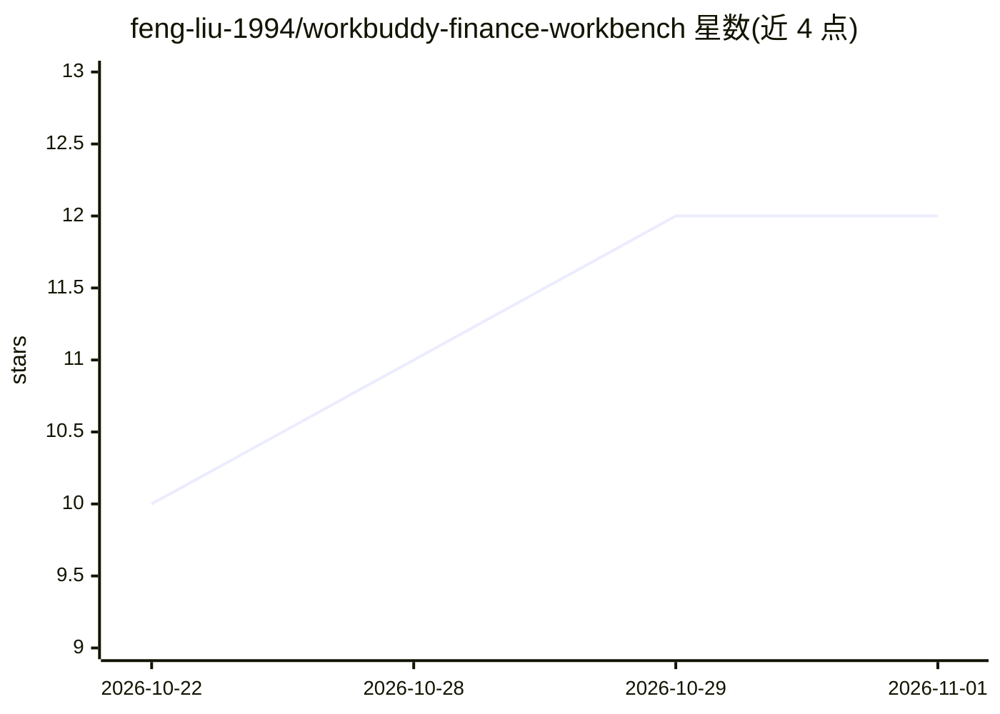

# feng-liu-1994/workbuddy-finance-workbench

⭐ 12 · JavaScript · MIT · 推送 2026-10-30 · [GitHub](https://github.com/feng-liu-1994/workbuddy-finance-workbench) · [官网](https://github.com/feng-liu-1994/workbuddy-finance-workbench/releases/latest) · 个人维护 · 中文 README

**面向财务人员的可视化财务工作台：20 模块、25 个 AI 工作流与异常闭环**

面向财务人员和财务 FDE 的开源工作台，覆盖收入、报销、核算、税务、报表与经营分析共 20 个工作模块，配套 25 个统一编号的 AI 工作流与可复制的完整提示词，以及异常责任闭环、月结证据控制、经营快照、JSON 备份与审计日志。提供三种承载方式：WorkBuddy 中以 MCP App 打开完整图形界面、DeepSeek Harness 中作为原生侧栏插件、其他 Agent 工具（Codex/Claude Code）读取通用 Skill。仓库仅含虚构演示数据，AI/OCR 结果不能替代人工复核；开发需 Node.js 20+。

## 筛选速览

| 维度 | 判定 | 备注 |
|---|---|---|
| AI 角色 | `ai-enhanced` | 去掉 AI 部分产品仍成立 |
| 许可风险 | `permissive` | MIT |
| 部署形态 | `None` |  |
| 模型依赖 | locked-api |  |
| 硬件要求 | — | 无带数字的原话,不猜 |
| 安装摩擦 | `low` | 无编译、无系统依赖或容器化 |
| 成熟度 | — | 结构信号不足 |

## 能力要点

- 20 个财务工作模块与 25 个统一编号的 AI 工作流（各含验收清单与人工复核点）
- 异常控制台按风险/金额/逾期排序，无处置证据不能关闭
- 三种承载方式：WorkBuddy MCP App、DeepSeek Harness 插件、通用 Agent Skill
- Widget 资源完全本地打包，数据存本机浏览器存储，可整体导出 JSON 备份

## 适用场景

- 财务人员按标准工作流录入、核算与复核账务并留痕
- 管理异常事项的责任人、期限与处置证据
- 在 Codex/Claude Code 等工具中复用财务规则与 25 份提示词

## 场景标签

`工作流自动化` `提示工程` · 领域:Agent 开发

## 证据(README 行号)

> L20: 这是一个面向财务人员和财务 FDE 场景的开源工作台。它不是只有提示词的 Skill：在 **WorkBuddy 中可直接打开完整交互界面**，在 **DeepSeek Harness 中可作为原生侧栏应用运行**，也保留通用 A
> L22: 界面采用克制的雾光层次与高可读字号，不使用夸张高光、塑料质感或密集小字。内置 20 个工作模块、25 个统一编号的 AI 工作流、25 份可查看与复制的完整提示词、异常责任闭环、月结证据控制、经营快照、资料索引和本机备份。
> L137: 仅查看界面可执行 `npm run preview`，然后打开 本机预览。预览可管理本机台账、备份与提示词；运行 AI 工作流需将指令粘贴到 AI 对话并添加附件。

## 星数曲线

2026-10-22 10 → 2026-11-01 12（+2）

---
*卡片 v1 · prompt 1.4 · 生成 2026-11-01 · 置信度 high · 依据 README sha `5b39503fb489` · [字段定义](../../DATASET.md)*
