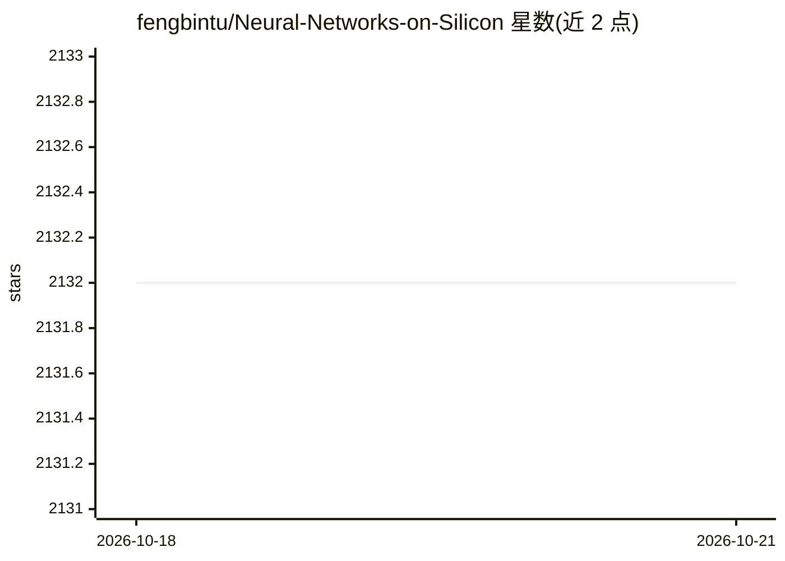

# fengbintu/Neural-Networks-on-Silicon

⭐ 2,132 · 推送 2026-03-30 · [GitHub](https://github.com/fengbintu/Neural-Networks-on-Silicon) · 个人维护

**AI 芯片与体系结构方向的研究论文收集清单**

由 HKUST 助理教授 Fengbin Tu 维护的个人论文选集：收录其关注的人工智能芯片、神经网络加速器与计算机体系结构方向的会议论文（ASPLOS、ISCA、MICRO、ISSCC、DAC、FPGA 等），按会议与年份组织；部分条目附带作者笔记（如数据流、量化、FPGA 映射等要点摘录）。内容以 2014-2016 年会议为主，并含维护者自述研究方向。纯文档型仓库，无安装或运行方式。

## 筛选速览

| 维度 | 判定 | 备注 |
|---|---|---|
| AI 角色 | `ai-knowledge` | 知识聚合/清单类 |
| 许可风险 | `none` | — |
| 部署形态 | `None` |  |
| 模型依赖 | — | README 未给出锁定关系 |
| 硬件要求 | — | 无带数字的原话,不猜 |
| 安装摩擦 | `low` | 无编译、无系统依赖或容器化 |
| 成熟度 | — | 结构信号不足 |

## 能力要点

- 按会议与年份组织 AI 芯片相关论文条目
- 部分论文附带维护者的要点笔记（架构、数据流、量化等）
- 覆盖 ASPLOS/ISCA/MICRO/ISSCC/DAC/FPGA 等体系结构会议

## 适用场景

- 查找神经网络加速器与 AI 芯片方向的经典论文
- 了解 AI 芯片与体系结构研究的会议脉络
- 获取论文作者与机构信息用于文献调研

## 场景标签

`科研工具` `精选清单` · 领域:学习与行业

## 证据(README 行号)

> L3: Fengbin Tu is an Assistant Professor and the Associate Director of the Institute of Integrated Circuits and Systems 
> L11: This is a collection of AI chip-related conference papers that interest me.

## 星数曲线

2026-10-18 2,132 → 2026-10-21 2,132（+0）

---
*卡片 v1 · prompt 1.4 · 生成 2026-10-21 · 置信度 high · 依据 README sha `63b74d276659` · [字段定义](../../DATASET.md)*
