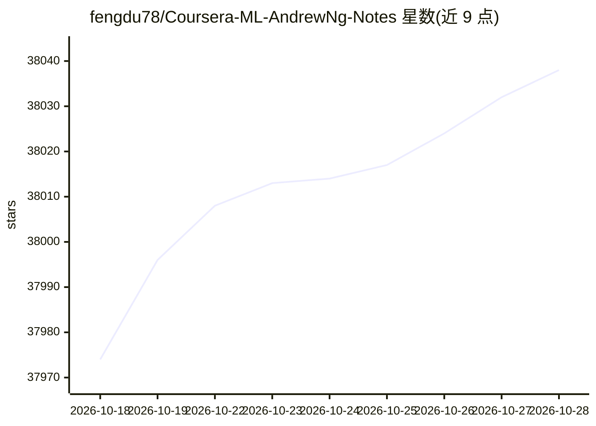

# fengdu78/Coursera-ML-AndrewNg-Notes

⭐ 38,038 · HTML · 推送 2026-10-05 · [GitHub](https://github.com/fengdu78/Coursera-ML-AndrewNg-Notes) · 个人维护 · 中文 README

**机器学习入门者的吴恩达课程中文学习笔记**

整理斯坦福 2014 年吴恩达机器学习课程的中文笔记，覆盖 10 周 18 节内容：监督学习、无监督学习、SVM、神经网络、推荐系统等。提供 markdown、word、html 三种笔记格式及 pdf 下载，随附课程原版 ppt 课件、中英文字幕（mp4 存百度云）、python 课程代码及 B 站课程视频链接。html 版公式已转为图片以便在线阅读。面向中文机器学习学习者。

## 筛选速览

| 维度 | 判定 | 备注 |
|---|---|---|
| AI 角色 | `ai-knowledge` | 知识聚合/清单类 |
| 许可风险 | `none` | — |
| 部署形态 | `None` |  |
| 模型依赖 | — | README 未给出锁定关系 |
| 硬件要求 | — | 无带数字的原话,不猜 |
| 安装摩擦 | `low` | 无编译、无系统依赖或容器化 |
| 成熟度 | — | 结构信号不足 |

## 动量与使用信号

- 维护:`active` — 距上次 push 13.0 天,年发版 0,11 位贡献者
- 涨星:近 1 天 **+6**(自 20261016 起算)
- 安装:github 包 `release-assets` 月下载无数据

## 能力要点

- 笔记提供 word/markdown/html 三种格式及 pdf 下载
- 附课程原版 ppt 与中英文字幕
- 包含课程 python 代码
- html 在线版公式已转为图片

## 适用场景

- 配合吴恩达 Coursera 机器学习课程做中文笔记阅读
- 下载课程字幕和 ppt 辅助自学
- 查阅课程配套 python 代码练习

## 场景标签

`教程课程` · 领域:学习与行业

## 证据(README 行号)

> L1: **斯坦福大学2014（吴恩达）机器学习教程中文笔记**
> L19: 本人2014年下半年开始翻译本课程字幕，并写了课程的中文笔记。笔记被下载了几万次，应该帮助了不少人，也有很多人一直在帮助我，现在我把笔记的**word**原稿和**markdown**原稿分享给大家。
> L21: **markdown**的笔记和课程中英文字幕我将放在**github**，希望大家能继续完善。为方便数学公式的在线显示，在线观看的是**html**文件，公式已经被转为图片，公式源码在**markdown**文件。

## 星数曲线

2026-10-18 37,974 → 2026-10-28 38,038（+64）

---
*卡片 v1 · prompt 1.4 · 生成 2026-10-18 · 置信度 high · 依据 README sha `b9c5c036df2d` · [字段定义](../../DATASET.md)*
