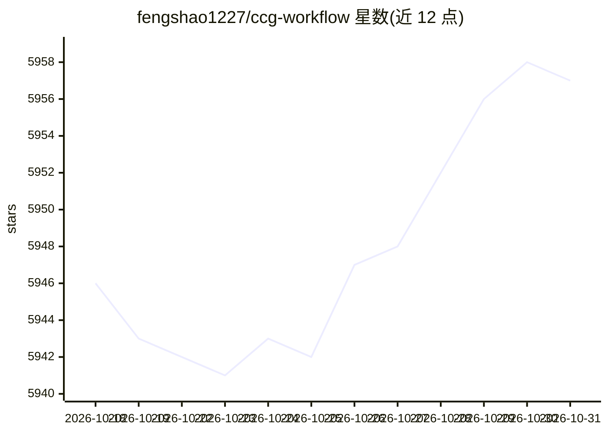

# fengshao1227/ccg-workflow

⭐ 5,957 · TypeScript · MIT · 推送 2026-10-21 · [GitHub](https://github.com/fengshao1227/ccg-workflow) · [官网](https://ccg.fengshao1227.com) · 个人维护 · 中文 README

**Claude Code 的多模型协作工作流引擎：/ccg:go 一条命令编排执行**

构建在 Claude Code 之上的工作流引擎：Claude 作为主协调器分析意图，从 10 种内置策略（如 full-collaborate、debug-investigate、review-audit）中自动选择，通过编译的 Go 二进制 codeagent-wrapper 将专项工作分派给 Codex、Grok、Kimi Code 等外部模型并行执行。提供 Hook 引擎在每轮注入任务状态、持久化任务目录、质量门（verify-security/quality 等）、100+ 领域知识文件按关键词注入、独立技能（宝塔面板部署、SEO 页面构建、AdSense 审计）以及 DeepSeek Harness 内的原生角色矩阵。要求 Node.js 20+ 与 Claude Code CLI，其他模型 CLI 为可选。以 npx 交互式向导安装。

## 筛选速览

| 维度 | 判定 | 备注 |
|---|---|---|
| AI 角色 | `ai-ecosystem` | LLM/agent 周边工具 |
| 许可风险 | `permissive` | MIT |
| 部署形态 | `library` | 以包/库形式分发 |
| 模型依赖 | locked-api |  |
| 硬件要求 | — | 无带数字的原话,不猜 |
| 安装摩擦 | `low` | 无编译、无系统依赖或容器化 |
| 成熟度 | `idea` | |

## 能力要点

- /ccg:go 智能入口：自动分析意图并从 10 种内置策略中选择
- Go 二进制 codeagent-wrapper 将 Claude 桥接至 Codex/Grok/Kimi 等外部模型并行工作
- 4 个 Hook 在每轮注入状态，上下文在压缩（compaction）后保留
- doctor --json 输出版本化健康检查报告，失败以退出码 1 结束

## 适用场景

- 在 Claude Code 里让多个外部模型并行协作完成复杂功能开发
- 对安全变更和大规模改动自动运行质量门检查
- 把构建产物经宝塔/aaPanel HTTP API 直接部署到服务器

## 场景标签

`工作流自动化` `编码 Agent` `多智能体` · 领域:Agent 开发

## 证据(README 行号)

> L98: **CCG is a workflow engine for Claude Code.** It turns Claude into a multi-model orchestrator — Claude stays in con
> L110: **Claude Code** is the lead orchestrator. It analyzes your intent, selects a strategy, and manages the entire work
> L234: Requires **Node.js 20+** and **Claude Code CLI**. Codex CLI, Grok CLI, Kimi Code CLI, and Antigravity are optional

## 星数曲线

2026-10-18 5,946 → 2026-10-31 5,957（+11）

---
*卡片 v1 · prompt 1.4 · 生成 2026-10-20 · 置信度 high · 依据 README sha `4dfd6c963c71` · [字段定义](../../DATASET.md)*
