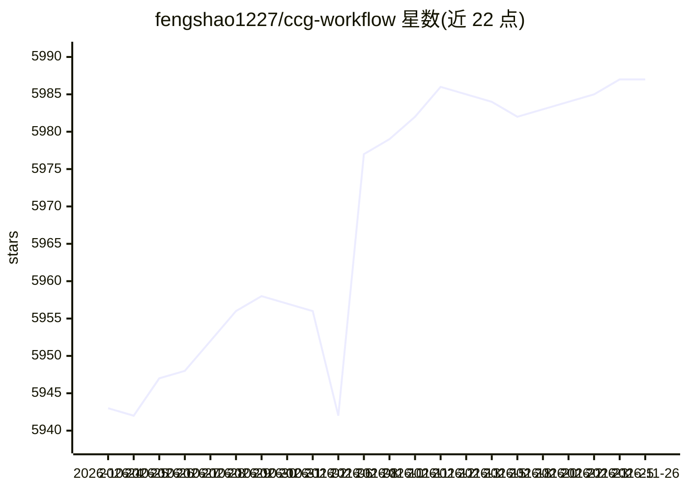

# fengshao1227/ccg-workflow

⭐ 5,987 · TypeScript · MIT · 推送 2026-11-19 · [GitHub](https://github.com/fengshao1227/ccg-workflow) · [官网](https://ccg.fengshao1227.com) · 个人维护 · 中文 README

**Claude Code 的多模型协作工作流引擎，自动编排 Codex/Gemini 等协作**

以 Claude Code 为主编排器的多模型工作流引擎：通过 Go 编写的 codeagent-wrapper 桥接 Codex、Grok、Kimi Code 等外部 CLI 做并行分析与交叉评审；Hook Engine 每回合注入任务状态防止压缩后丢上下文；内置 10 种按任务复杂度自动选择的策略、持久化任务目录、5 个质量门命令和 61 个按关键词自动注入的领域知识文件。通过 npx 安装，需 Node.js 20+ 与 Claude Code CLI，其余外部 CLI 为可选。

## 筛选速览

| 维度 | 判定 | 备注 |
|---|---|---|
| AI 角色 | `ai-ecosystem` | LLM/agent 周边工具 |
| 许可风险 | `permissive` | MIT |
| 部署形态 | `library` | 以包/库形式分发 |
| 模型依赖 | locked-api |  |
| 硬件要求 | — | 无带数字的原话,不猜 |
| 安装摩擦 | `low` | 无编译、无系统依赖或容器化 |
| 成熟度 | `idea` | |

## 能力要点

- Claude 为编排核心，经 Go binary 桥接 Codex/Grok/Kimi Code 等外部模型协作
- 4 个 JavaScript Hook 每回合注入状态，上下文在 compaction 后仍保留
- 10 种内置策略按任务类型与复杂度自动选择
- 附 DeepSeek Harness 内置包 dsh-ccg，支持多模型并行面板与常驻 teammate

## 适用场景

- 一条命令描述需求，自动编排多模型完成开发任务
- 复杂变更需要多模型交叉评审与安全/质量门检查
- 长会话开发中避免上下文压缩后丢失任务状态

## 场景标签

`编码 Agent` `多智能体` · 领域:Agent 开发

## 证据(README 行号)

> L98: **CCG is a workflow engine for Claude Code.** It turns Claude into a multi-model orchestrator — Claude stays in con
> L110: **Claude Code** is the lead orchestrator. It analyzes your intent, selects a strategy, and manages the entire work

## 星数曲线

2026-10-24 5,943 → 2026-11-26 5,987（+44）

---
*卡片 v1 · prompt 1.4 · 生成 2026-11-22 · 置信度 high · 依据 README sha `2654271343f7` · [字段定义](../../DATASET.md)*
