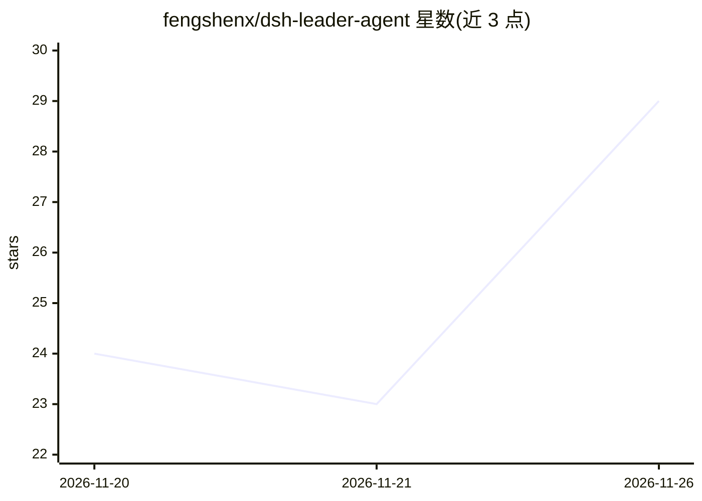

# fengshenx/dsh-leader-agent

⭐ 29 · JavaScript · MIT · 推送 2026-11-25 · [GitHub](https://github.com/fengshenx/dsh-leader-agent) · [官网](https://fengshenx.github.io/dsh-leader-agent/) · 个人维护 · 中文 README

**为 dsh 提供 Leader/worker 编排的插件：一人并行管理多个 agent 会话**

面向 DeepSeek Harness（dsh）的编排插件：用户设定目标后，由 Leader 会话拆分任务、spawn_worker 派发 worker、跟踪完成情况、核验交付并组织 review；每个项目一块交付看板，卡片带执行槽与实时状态灯，可点击槽位进入 worker 会话继续对话。机制上由运行时决定工具面（仅 Leader 有 spawn_worker/message_worker）、worker 回合结束自动唤醒 Leader、worker 为持久根会话可冷恢复；编排协议由 LEADER.md/SLOTS.md/leader-mode skill 三个文件承载，worker 静默 15 分钟触发后台巡查通知。限制：Leader 不能停止 worker，初始化需手写配置文件。

## 筛选速览

| 维度 | 判定 | 备注 |
|---|---|---|
| AI 角色 | `ai-ecosystem` | LLM/agent 周边工具 |
| 许可风险 | `permissive` | MIT |
| 部署形态 | `None` |  |
| 模型依赖 | — | README 未给出锁定关系 |
| 硬件要求 | — | 无带数字的原话,不猜 |
| 安装摩擦 | `medium` | 含编译或系统依赖之一 |
| 成熟度 | — | 结构信号不足 |

## 能力要点

- 一个 Leader 拆分、派发、跟踪并核验多个并行 worker 的任务
- 每项目一块交付看板，卡片带执行槽与实时状态灯
- 运行时裁剪工具面：Leader 与 worker 的可用工具由身份决定
- read_worker_session 只读回放 worker 会话，不唤醒、不触发模型调用

## 适用场景

- 同时推进多个功能开发，由 Leader 代管各 agent 会话
- 通过看板跟踪每个任务的执行者与状态
- 调试时只读回看 worker 的执行过程而不打扰它

## 场景标签

`多智能体` `编码 Agent` · 领域:Agent 开发

## 证据(README 行号)

> L17: > A leader / worker orchestration bundle for DeepSeek Harness (dsh). The Leader splits work, dispatches it, tracks 
> L83: - **Identity decides the tool surface.** The Leader gets `spawn_worker` / `message_worker`; workers don't. The host
> L90: - This project does not aim to rebuild dsh's own super agent. It solves one concrete problem: letting one person ma

## 星数曲线

2026-11-20 24 → 2026-11-26 29（+5）

---
*卡片 v1 · prompt 1.4 · 生成 2026-11-20 · 置信度 high · 依据 README sha `ea6b7078bf65` · [字段定义](../../DATASET.md)*
