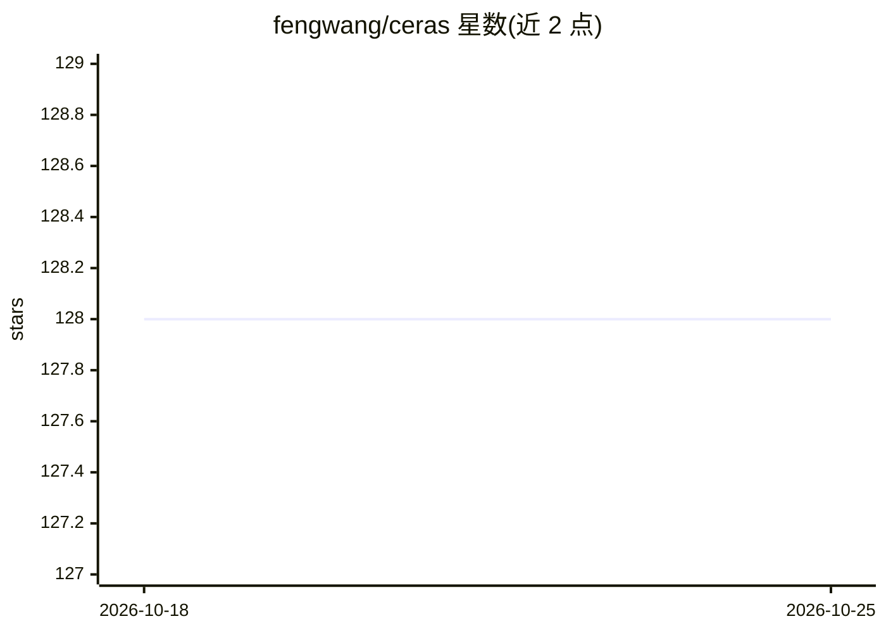

# fengwang/ceras

⭐ 128 · C++ · 推送 2026-10-03 · [GitHub](https://github.com/fengwang/ceras) · 个人维护

**C++20 header-only 深度学习引擎：以类 Keras 语法构建训练神经网络**

纯 C++20 实现的 header-only 深度学习引擎，目标是以 Keras 风格 API 在 C++ 中定义计算图并训练模型。提供高层 model 接口（Input/Dense/compile/fit/predict）与中层 API（place_holder、variable、session、优化器），通过表达式模板表示计算图。数值核心仅头文件，CUDA 与 CBLAS 为可选加速后端（CUDA 会覆盖 CBLAS）；文档注明因 Non-Type Template Parameters 未实现，仅 gcc 可用，clang 不支持。构建与回归测试使用 CMake preset。

## 筛选速览

| 维度 | 判定 | 备注 |
|---|---|---|
| AI 角色 | `ai-native` | 本体是模型或模型工具 |
| 许可风险 | `none` | — |
| 部署形态 | `None` |  |
| 模型依赖 | — | README 未给出锁定关系 |
| 硬件要求 | — | 无带数字的原话,不猜 |
| 安装摩擦 | `high` | 编译与系统依赖俱全 |
| 成熟度 | — | 结构信号不足 |

## 能力要点

- 类 Keras 的高层 API 与基于 session/computation graph 的中层 API
- 数值核心 header-only，CUDA/CBLAS 为可选加速（GEMM 等耗时操作）
- 文档报告 MNIST 10 epoch 98% 精度 30 秒（i7-7700HQ + GTX 1060 笔记本）
- 附 VGG16、UNet 等模型构建示例

## 适用场景

- 在 C++ 项目中直接嵌入神经网络训练与推理，不依赖 Python 栈
- 以中层 API 学习计算图、张量与优化器的实现细节
- 用可选 CUDA/CUBLAS 后端加速大规模 GEMM 运算

## 场景标签

`模型训练` · 领域:训练与推理

## 证据(README 行号)

> L5: __Ceras__ is yet another deep learning engine aiming to reinvent Keras, in C++20. The numerical core is header-only;
> L25: A `model` is a way to organize layers. Here is an example to build a sequential model.
> L186: ## Features

## 星数曲线

2026-10-18 128 → 2026-10-25 128（+0）

---
*卡片 v1 · prompt 1.4 · 生成 2026-10-22 · 置信度 high · 依据 README sha `0579ab801606` · [字段定义](../../DATASET.md)*
