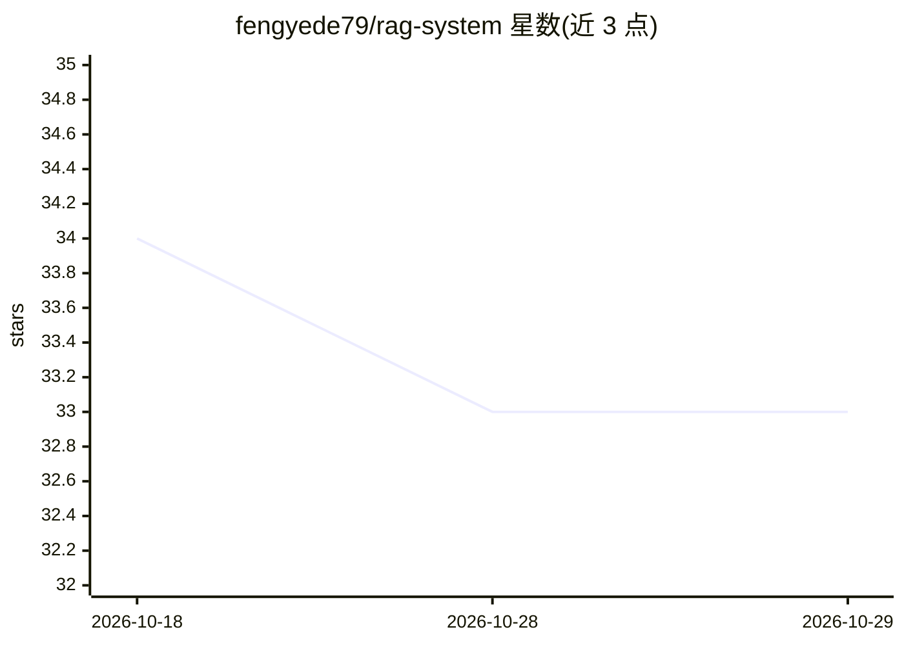

# fengyede79/rag-system

⭐ 33 · Python · 推送 2026-07-08 · [GitHub](https://github.com/fengyede79/rag-system) · 个人维护 · 中文 README

**中文食谱问答的端到端 RAG 系统工程实践**

以食谱问答为落地场景的检索增强生成系统，面向开发者展示完整 RAG 工程闭环：数据清洗与 FAISS 索引构建、向量+BM25+RRF 混合检索、多轮会话状态管理与指代解析、结构化答案生成与 SSE 流式输出，通过 Flask 提供 Web/API 服务。模型调用依赖 DashScope API（qwen-plus-2025-07-28），并提供 85 轮真实服务的 Live E2E 测评（通过率 90.6%）。README 亦列出多轮指代与低证据 fallback 等待优化方向。

## 筛选速览

| 维度 | 判定 | 备注 |
|---|---|---|
| AI 角色 | `ai-native` | 本体是模型或模型工具 |
| 许可风险 | `none` | — |
| 部署形态 | `library` | 以包/库形式分发 |
| 模型依赖 | — | README 未给出锁定关系 |
| 硬件要求 | — | 无带数字的原话,不猜 |
| 安装摩擦 | `low` | 无编译、无系统依赖或容器化 |
| 成熟度 | — | 结构信号不足 |

## 能力要点

- 向量检索+BM25+RRF 融合、元数据过滤与低证据保护的混合检索
- Turn Understanding/Reference Resolution/ContextPacker/StateUpdatePolicy 模块化 runtime
- 结构化生成优先与 SSE 流式输出
- 85 轮真实服务 Live E2E 测评闭环（总通过率 90.6%）

## 适用场景

- 搭建中文食谱多轮问答服务
- 参考 RAG 工程化架构做检索与状态管理实现
- 用真实大模型服务做端到端测评验证

## 场景标签

`RAG` · 领域:知识与检索

## 证据(README 行号)

> L3: 面向中文问答场景的端到端检索增强生成系统。当前项目以食谱问答为落地场景，完整覆盖数据清洗、索引构建、混合检索、多轮状态管理、结构化生成、流式服务和 Live E2E 大模型实测闭环。
> L5: 这个仓库不是一个只调用 LLM API 的问答 Demo，而是一次完整的 RAG 工程实践：系统把一次用户请求拆解为安全检查、轮次理解、指代解析、执行计划、检索执行、证据质量判断、上下文打包、答案生成和状态提交，并用真实服务与真实模
> L53: 最终展示口径来自 2026-07-08 的 Live E2E 结果，模型为 `qwen-plus-2025-07-28`。这组测试会启动真实 Flask 服务，通过 HTTP/SSE 调用真实接口，并使用真实大模型配置执行多轮场景

## 星数曲线

2026-10-18 34 → 2026-10-29 33（-1）

---
*卡片 v1 · prompt 1.4 · 生成 2026-10-25 · 置信度 mid · 依据 README sha `4831969bd0a8` · [字段定义](../../DATASET.md)*
