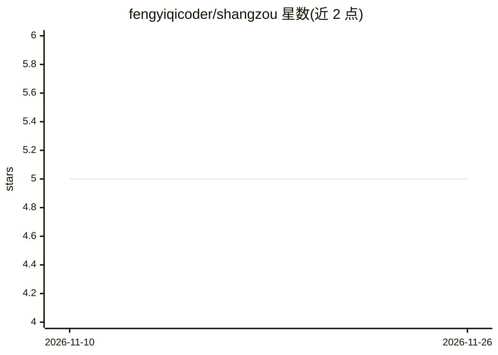

# fengyiqicoder/shangzou

⭐ 5 · JavaScript · MIT · 推送 2026-11-08 · [GitHub](https://github.com/fengyiqicoder/shangzou) · [官网](https://shangzou.000ooo.ooo/) · 个人维护 · 中文 README

**给明清三位皇帝写奏折、获 AI 模拟朱批的静态网页**

纯静态页面，无后端，GitHub Pages 托管。用户选择嘉靖/康熙/雍正之一，设定年份与官职，用白话陈述事项；可由 AI 誊写成文言奏文，随后观看按史实路线的折子流转动画并收到 AI 生成的朱批或批红。版式按明清体例实现竖排、抬头、臣字偏书等细节。AI 调用通过 OneTag AI 的浏览器端脚本完成；自部署需替换为自己的 key。批语为 AI 模拟，非真实档案。

## 筛选速览

| 维度 | 判定 | 备注 |
|---|---|---|
| AI 角色 | `ai-native` | 本体是模型或模型工具 |
| 许可风险 | `permissive` | MIT |
| 部署形态 | `None` |  |
| 模型依赖 | — | README 未给出锁定关系 |
| 硬件要求 | — | 无带数字的原话,不猜 |
| 安装摩擦 | `low` | 无编译、无系统依赖或容器化 |
| 成熟度 | — | 结构信号不足 |

## 能力要点

- 三朝各有独立的折子流转路线（票拟批红/驿递/军机处）
- 竖排经折装排版：抬头、偏书、可关闭的句读小点
- 白话可由 AI 誊写为该朝体例的文言奏文
- Fork 仓库并替换 OneTag key 即可自行部署

## 适用场景

- 写一道奏折体验皇帝朱批回复
- 了解明清奏折流转流程与文书体例
- Fork 后添加其他皇帝并提交 PR

## 场景标签

`AI 写作` · 领域:内容生成

## 证据(README 行号)

> L32: 批语是 AI 模拟的，不是真实档案。
> L36: 一个纯静态页面，没有后端，GitHub Pages 托管。AI 调用只有一行 script：
> L45: OneTag AI 让静态网页直接调用大模型，key 写在页面里就行。

## 星数曲线

2026-11-10 5 → 2026-11-26 5（+0）

---
*卡片 v1 · prompt 1.4 · 生成 2026-11-21 · 置信度 high · 依据 README sha `af39f182671a` · [字段定义](../../DATASET.md)*
