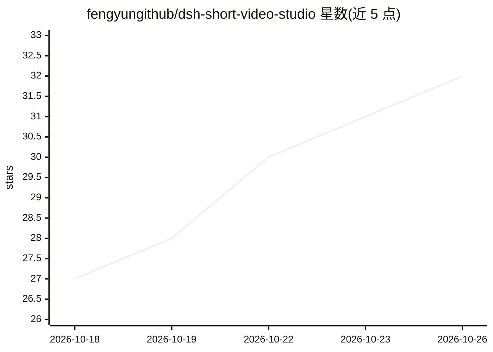

# fengyungithub/dsh-short-video-studio

⭐ 32 · JavaScript · Apache-2.0 · 推送 2026-10-23 · [GitHub](https://github.com/fengyungithub/dsh-short-video-studio) · 个人维护 · 中文 README

**本地 ComfyUI 驱动的 AI 短视频/动画创作工作台插件**

作为 DeepSeek Harness 的双面插件运行：Agent 按 skill 定义的生产流程（简报→大纲→角色卡→镜头表→分镜→逐镜生成→拼接）编排任务，把生成请求派发到本地 ComfyUI 执行，产物落到可视化画布。默认工作流用 FLUX 2 出图、MiniMax H3 出带声音视频，但模型与场景解耦——任何 ComfyUI 工作流可通过导入 JSON 清单接入。支持 2K/4K 放大路线、同场景链式续接、声线锁定、飞书远程操控。面向使用 DSH 的创作者，前置要求本机或远程已运行 ComfyUI 并下载模型，A800 级显卡实测数据在 README 中给出。

## 筛选速览

| 维度 | 判定 | 备注 |
|---|---|---|
| AI 角色 | `ai-native` | 本体是模型或模型工具 |
| 许可风险 | `permissive` | Apache-2.0 |
| 部署形态 | `None` |  |
| 模型依赖 | locked-api |  |
| 硬件要求 | — | 无带数字的原话,不猜 |
| 安装摩擦 | `medium` | 含编译或系统依赖之一 |
| 成熟度 | — | 结构信号不足 |

## 能力要点

- skill 与 workflow 双扩展：换模型只需增删一份 JSON 清单
- 三条 2K/4K 放大路线（两阶段潜空间放大 / 学习式 latent ×2 / 逐帧 CNN 视频超分）
- 同场景续接镜：上一镜服务端 latent 链式钉入本镜，音频从接缝继续
- 飞书远程操控：画布产物自动送达飞书，聊天里收片审片下指令

## 适用场景

- 用一句话需求产出 30 秒 3D 动画短片成片
- 短剧系列制片：分集剧本到单集成片的全流程管理
- 通过导入自定义 ComfyUI 工作流替换默认模型做品牌宣传/电商视频

## 场景标签

`工作流自动化` `图像生成` `视频生成` · 领域:效率与自动化

## 证据(README 行号)

> L4: **完全本地 · 免费 · 零云端依赖**的**短剧 / 动画画布工作室**，作为 DeepSeek Harness 双面插件运行。所有生成都跑在**本地 ComfyUI** 上——不需要任何付费云 API、不消耗额度，装好即用，一
> L8: > 一句话：**Agent 按你定义的 skill 编排流程，把生成请求派发到本地 ComfyUI 执行，产物落进可视化画布，还能通过飞书远程操控创作。**
> L100: 开始创作：在会话里说

## 星数曲线

2026-10-18 27 → 2026-10-26 32（+5）

---
*卡片 v1 · prompt 1.4 · 生成 2026-10-26 · 置信度 high · 依据 README sha `ed83211401fa` · [字段定义](../../DATASET.md)*
