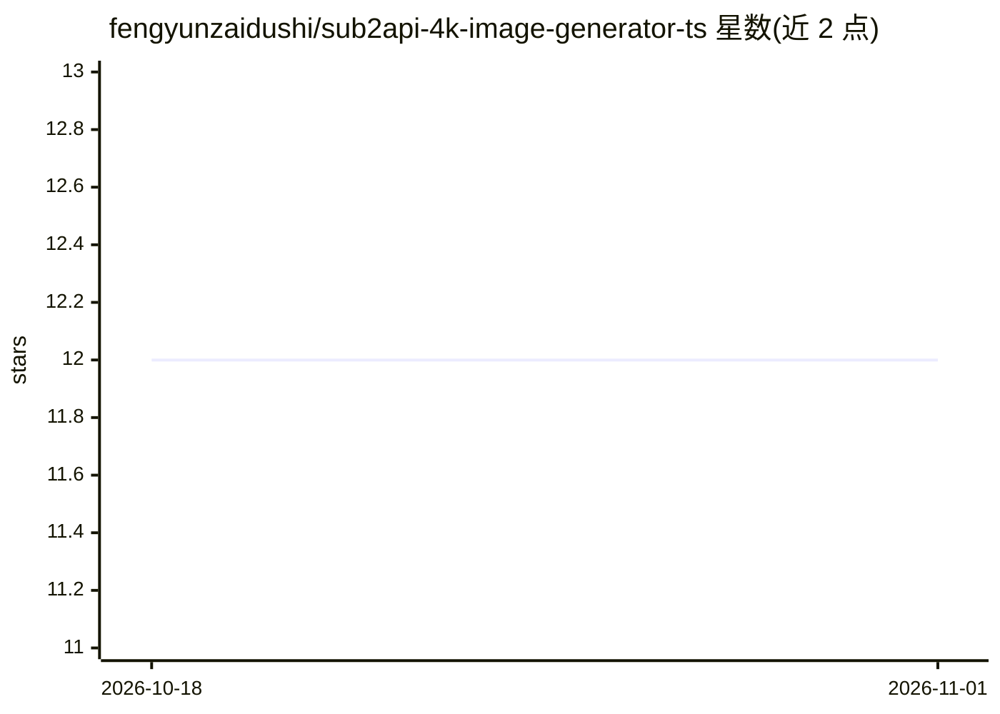

# fengyunzaidushi/sub2api-4k-image-generator-ts

⭐ 12 · TypeScript · MIT · 推送 2026-07-03 · [GitHub](https://github.com/fengyunzaidushi/sub2api-4k-image-generator-ts) · 个人维护 · 中文 README

**Codex skill/TS CLI：经自托管 sub2api 端点生成 4K AI 图片**

既是可安装到 Codex 的 agent skill，也是独立的 TypeScript CLI 与 Python 脚本：通过用户自部署的 sub2api OpenAI-compatible endpoint 调用 /v1/images/generations 或 /v1/responses，生成 3840x2160 / 2160x3840 的 4K 图片，默认走 streaming 以降低 Cloudflare 524 超时概率，从 SSE 中捕获最终图与 partial 诊断图并保存。凭据从本地 .env 读取，输出不打印完整 API key。适合使用自托管 sub2api 部署、需要在 agent 或命令行中产出高分辨率图片的用户。

## 筛选速览

| 维度 | 判定 | 备注 |
|---|---|---|
| AI 角色 | `ai-native` | 本体是模型或模型工具 |
| 许可风险 | `permissive` | MIT |
| 部署形态 | `library` | 以包/库形式分发 |
| 模型依赖 | — | README 未给出锁定关系 |
| 硬件要求 | — | 无带数字的原话,不猜 |
| 安装摩擦 | `low` | 无编译、无系统依赖或容器化 |
| 成熟度 | — | 结构信号不足 |

## 能力要点

- 默认 streaming 请求以规避 Cloudflare 524 超时
- 解析 SSE 中的 final image 与 partial diagnostic image
- 支持 /v1/images/generations 与 /v1/responses 两种 endpoint
- API key 掩码输出，另附 Cloudflare 1010/524 诊断说明

## 适用场景

- 在 Codex agent 中用自然语言提示词生成 4K 图片并拿到保存路径
- 通过命令行向自托管 sub2api 端点发起流式图片生成请求
- 排查慢速 4K 生成任务的 524 超时与 partial image 问题

## 场景标签

`图像生成` · 领域:内容生成

## 证据(README 行号)

> L7: 这是一个 Codex 可用的 agent skill，同时也是一个 TypeScript CLI，用来通过 sub2api 的 OpenAI-compatible endpoint 生成、流式接收、保存和调试高分辨率 AI 图片。
> L9: 当你需要基于本地 `SUB2API_BASE_URL` / `SUB2API_API_KEY` 调用 `/v1/images/generations` 或 `/v1/responses` 时可以使用它，尤其适合 `3840x2160
> L70: - 从 SSE event 中捕获 final image 和 partial diagnostic image

## 星数曲线

2026-10-18 12 → 2026-11-01 12（+0）

---
*卡片 v1 · prompt 1.4 · 生成 2026-11-01 · 置信度 mid · 依据 README sha `6bc05c2a2008` · [字段定义](../../DATASET.md)*
