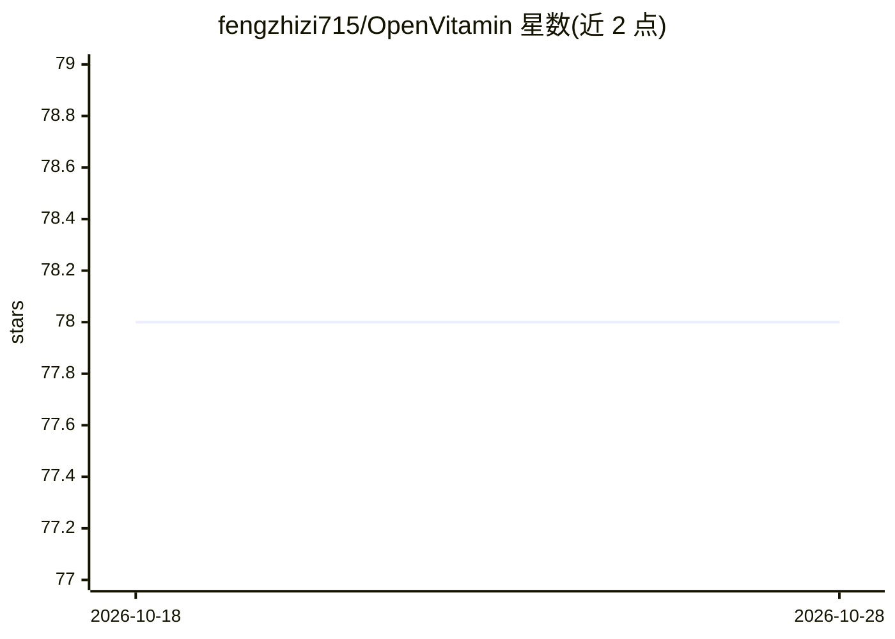

# fengzhizi715/OpenVitamin

⭐ 78 · Python · Apache-2.0 · 推送 2026-07-07 · [GitHub](https://github.com/fengzhizi715/OpenVitamin) · 个人维护 · 中文 README

**本地优先 AI 平台：统一推理网关、智能体与工作流编排**

面向个人与团队的可私有部署 AI 平台，采用 Vue 前端 + FastAPI 推理网关架构。网关统一接入 Ollama、LM Studio、本地 GGUF、OpenAI 兼容 API 等多种推理后端，覆盖 LLM/VLM/Embedding/ASR/文生图能力；上层提供多模态聊天、Agent 系统（Plan-Based 执行、Skill 发现、Tool 调用）、Workflow Control Plane（版本化、分支/循环治理）、知识库与 RAG。以源码方式部署，需 Python 3.11+、Node.js 18+ 与 Conda；开源版默认 SQLite，README 声明开源版落后商业版 2-4 周。

## 筛选速览

| 维度 | 判定 | 备注 |
|---|---|---|
| AI 角色 | `ai-ecosystem` | LLM/agent 周边工具 |
| 许可风险 | `permissive` | Apache-2.0 |
| 部署形态 | `library` | 以包/库形式分发 |
| 模型依赖 | local-ok | 支持本地模型 |
| 硬件要求 | — | 无带数字的原话,不猜 |
| 安装摩擦 | `low` | 无编译、无系统依赖或容器化 |
| 成熟度 | `idea` | |

## 能力要点

- 统一推理网关接入 Ollama、本地 GGUF、OpenAI 兼容 API 等多后端
- Agent 系统支持 Plan-Based 执行、Skill 语义发现、Intent Rules 与 Tool 调用
- Workflow Control Plane 支持版本化、执行历史与分支/循环治理
- 文生图工作台支持异步任务、历史、缩略图、warmup 与取消

## 适用场景

- 统一管理本地与云端模型，做多模态聊天与视觉任务
- 用 Agent + Skill + Tool 组织能力并用 Workflow 编排多步流程
- 本地运行文生图模型并管理生成任务
- 将 OpenClaw 作为上游模型后端接入统一网关

## 场景标签

`模型网关` `工作流自动化` `图像生成` `Agent 框架` · 领域:Agent 开发

## 证据(README 行号)

> L11: **技术架构**：采用 **Vue 前端 + FastAPI 推理网关**。网关统一接入多种推理后端（如 Ollama、LM Studio、本地 GGUF、OpenAI 兼容 API 等），并支持与 OpenClaw 进行后端集成
> L15: - **推理网关**：中枢，负责模型路由、请求编排与执行策略
> L20: - 统一推理网关，覆盖 `LLM`、`VLM`、`Embedding`、`ASR` 与 `Image Generation`

## 星数曲线

2026-10-18 78 → 2026-10-28 78（+0）

---
*卡片 v1 · prompt 1.4 · 生成 2026-10-24 · 置信度 mid · 依据 README sha `94b0478918a0` · [字段定义](../../DATASET.md)*
