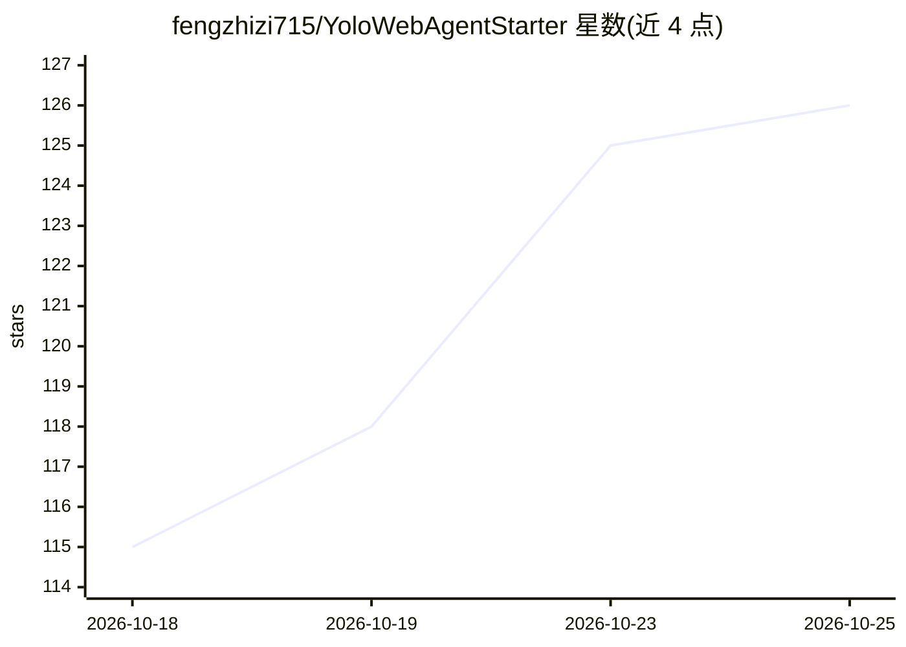

# fengzhizi715/YoloWebAgentStarter

⭐ 128 · Python · MIT · 推送 2026-10-25 · [GitHub](https://github.com/fengzhizi715/YoloWebAgentStarter) · 个人维护 · 中文 README

**本地单用户 YOLO 数据集工作台：标注、训练、评估加 AI 助手**

面向本地单用户的 YOLO 数据集闭环工具：支持 detect/segment/OBB/classify 四类任务的图片与视频抽帧导入、人工标注、数据校验、YOLO/COCO 格式交换、CPU/MPS/CUDA（含多 GPU DDP）本地训练、原生 Ultralytics val 评估与受管模型产物（PT/ONNX）。附带四种 Agent 助手模式，写操作须人工确认；默认使用本地 Mock/规则规划，可配置 Chat Completions 兼容接口接入真实 LLM。数据默认留在本机，不提供认证与多租户。另有商业版本可咨询。

## 筛选速览

| 维度 | 判定 | 备注 |
|---|---|---|
| AI 角色 | `ai-native` | 本体是模型或模型工具 |
| 许可风险 | `permissive` | MIT |
| 部署形态 | `library` | 以包/库形式分发 |
| 模型依赖 | — | README 未给出锁定关系 |
| 硬件要求 | — | 无带数字的原话,不猜 |
| 安装摩擦 | `medium` | 含编译或系统依赖之一 |
| 成熟度 | — | 结构信号不足 |

## 能力要点

- detect/segment/OBB/classify 四任务的标注、本地训练与原生 val 评估闭环
- Agent MVP：四种助手模式共享执行器，写操作须人工确认
- SAM 框选/点选分割建议，需用户确认后保存
- 默认监听 127.0.0.1，数据、数据库与产物保留在本机

## 适用场景

- 在本机完成 YOLO 数据集的标注、训练与评估全流程
- 用本地自动标注任务（受管 PT）加速预标注，再人工审核
- 通过 AI 助手查询数据集状态、诊断训练失败、生成模型可比性报告
- 导出 YOLO/COCO 格式与其他工具交换数据

## 场景标签

`目标检测` · 领域:感知与多模态

## 证据(README 行号)

> L5: YoloWebAgentStarter 是面向本地单用户的 YOLO 数据集工作台：完成图片/视频帧导入、人工标注、数据校验、YOLO/COCO 交换、本地训练、原生 YOLO 评估和受管模型产物的一条轻量闭环，并提供基于工具证据的
> L11: - 在本机完成 detect、segment、OBB 和 classify 数据集的标注与训练准备。
> L15: - 训练页可选择 CPU、MPS、单张 CUDA GPU 或多张 CUDA GPU；本地多 GPU 使用 Ultralytics DDP。

## 星数曲线

2026-10-18 115 → 2026-10-25 126（+11）

---
*卡片 v1 · prompt 1.4 · 生成 2026-10-23 · 置信度 mid · 依据 README sha `66012b233998` · [字段定义](../../DATASET.md)*
