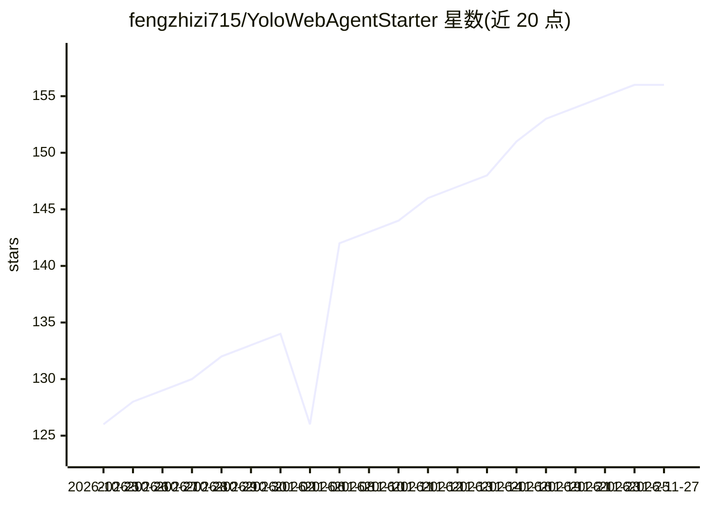

# fengzhizi715/YoloWebAgentStarter

⭐ 156 · Python · MIT · 推送 2026-11-26 · [GitHub](https://github.com/fengzhizi715/YoloWebAgentStarter) · 个人维护 · 中文 README

**本地单用户 YOLO 数据集标注训练评估工作台，带智能助手**

面向本地单用户的 YOLO 数据集闭环工具：覆盖图片/视频帧导入、detect/segment/OBB/classify 四类任务的人工标注、数据校验、YOLO/COCO 互换、本地训练（CPU/MPS/CUDA，多卡走 Ultralytics DDP）、原生 val 评估与受管 PT/ONNX 产物管理。内置 Agent MVP 提供综合/数据集/训练/模型四种助手模式，默认本地 Mock/规则规划，可接入 OpenAI 兼容接口，写操作须人工确认。限制：仅 macOS/Linux、单用户、无认证与云训练，自动标注结果须人工审核。

## 筛选速览

| 维度 | 判定 | 备注 |
|---|---|---|
| AI 角色 | `ai-ecosystem` | LLM/agent 周边工具 |
| 许可风险 | `permissive` | MIT |
| 部署形态 | `library` | 以包/库形式分发 |
| 模型依赖 | — | README 未给出锁定关系 |
| 硬件要求 | — | 无带数字的原话,不猜 |
| 安装摩擦 | `medium` | 含编译或系统依赖之一 |
| 成熟度 | — | 结构信号不足 |

## 能力要点

- detect/segment/OBB/classify 四任务的标注、交换、训练与原生评估闭环
- SAM 框/点提示的 segment 建议，建议须经用户确认后保存
- Agent MVP 四种助手模式：只读证据查询，写操作人工确认后提交任务
- 默认仅监听 127.0.0.1，数据、模型与日志保留在本机

## 适用场景

- 在本机完成 YOLO 数据集的标注、校验与训练准备
- 训练后对比同数据集多个模型的可比性并审阅错误样本
- 用受管 PT 对新图片做自动标注并人工审核
- 通过对话式助手诊断训练失败原因

## 场景标签

`目标检测` · 领域:感知与多模态

## 证据(README 行号)

> L5: YoloWebAgentStarter 是面向本地单用户的 YOLO 数据集工作台：完成图片/视频帧导入、人工标注、数据校验、YOLO/COCO 交换、本地训练、原生 YOLO 评估和受管模型产物的一条轻量闭环，并提供基于工具证据的
> L22: - Agent MVP：内置综合、数据集、训练、模型四种助手模式，共享执行器；提供训练准备、失败诊断与模型可比性报告。写操作须人工确认后才提交现有受管任务，不自动串联下一步。支持对象绑定会话、异步进度、取消及保留原模式与权限的重试
> L39: |Agent MVP|四种内置助手模式、对象绑定会话、只读问答与诊断报告；人工确认后提交训练/评估/自动标注任务；异步运行、取消、重试、逐轮证据与推理来源；会话和消息分页、服务端会话搜索；LLM 设置保存到 `settings.j

## 星数曲线

2026-10-25 126 → 2026-11-27 156（+30）

---
*卡片 v1 · prompt 1.4 · 生成 2026-11-27 · 置信度 mid · 依据 README sha `438eccdb1607` · [字段定义](../../DATASET.md)*
