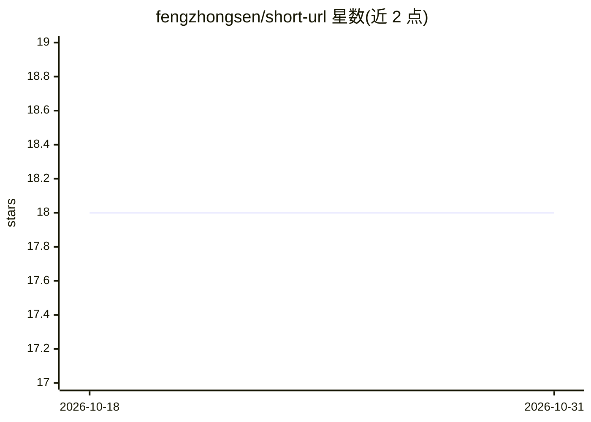

# fengzhongsen/short-url

⭐ 18 · JavaScript · MIT · 推送 2025-12-19 · [GitHub](https://github.com/fengzhongsen/short-url) · [官网](https://short.ifelse.site) · 个人维护 · 中文 README

**可私有化部署的短链接生成服务，含 MCP 集成**

Fork 自 onee-io/short-url 并重构的短链接工具：Monorepo 结构（React+Antd 前端、Express+Redis 后端、MCP Server），支持注册/登录、用户短链数量限制（默认 10 条）、JWT 与密码加密。附带 MCP 服务，供 Claude Desktop、VS Code + Cline 等 AI 助手直接调用生成短链接，需配置 API Key。运行需 NodeJS 16+ 与 Redis 5+，提供 Docker Compose 与手动部署两种方式，MIT 许可。

## 筛选速览

| 维度 | 判定 | 备注 |
|---|---|---|
| AI 角色 | `ai-ecosystem` | LLM/agent 周边工具 |
| 许可风险 | `permissive` | MIT |
| 部署形态 | `self-host` | docker 或自建部署 |
| 模型依赖 | — | README 未给出锁定关系 |
| 硬件要求 | — | 无带数字的原话,不猜 |
| 安装摩擦 | `low` | 无编译、无系统依赖或容器化 |
| 成熟度 | — | 结构信号不足 |

## 能力要点

- 长链接转短链接，可私有化部署，短链永久有效
- 提供 MCP Server 供 Claude Desktop / VS Code + Cline 等 AI 助手调用
- Monorepo 结构：前端 React+Antd、后端 Express+Redis、独立 MCP 服务包
- 支持注册/登录与 API Key，Docker Compose 一键部署

## 适用场景

- 自建短链服务替代第三方短链平台
- 让 AI 助手在对话中直接生成短链接
- 为团队提供带账号管理的内部短链服务

## 场景标签

 · 领域:Web 工具/自托管服务

## 证据(README 行号)

> L24: 该项目起初 Fork 自 onee-io/short-url ，在工程方面进行了全面重构（采用 Monorepo 结构），UI 基于 Antd6 重写，同时增加了注册/登录/登出等能力，短链生成算法也采用了业界最佳实践，并增加了 
> L32: - `packages/short-mcp-server`: MCP 服务 (用于 AI 助手集成)
> L90: 本项目提供了 MCP (Model Context Protocol) Server，允许 AI 助手（如 Claude Desktop, VS Code + Cline 等）直接调用你的短链服务生成短链接。

## 星数曲线

2026-10-18 18 → 2026-10-31 18（+0）

---
*卡片 v1 · prompt 1.4 · 生成 2026-10-29 · 置信度 high · 依据 README sha `8c4f8f33a940` · [字段定义](../../DATASET.md)*
