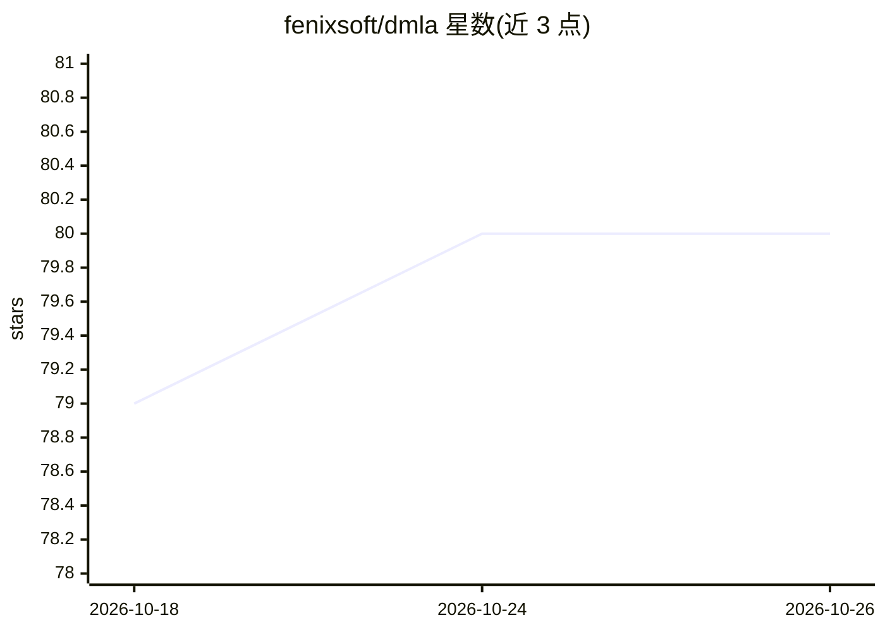

# fenixsoft/dmla

⭐ 80 · Python · NOASSERTION · 推送 2026-10-12 · [GitHub](https://github.com/fenixsoft/dmla) · [官网](https://ai.icyfenix.cn) · 个人维护 · 中文 README

**面向软件工程师的机器学习应用系统设计开放书籍**

一本关于“如何将机器学习应用于生产系统”的中文技术书籍，作者为软件工程师兼机器学习方向博士生，定位是帮助开发者在人工智能时代组织知识体系。内容分数学基础、经典统计学习算法、深度学习等部分，配套可在浏览器中直接运行的代码沙箱演示算法与模型训练；数学与经典部分纯 CPU 即可，深度学习部分实验基于 PyTorch 与 CUDA 12.8 需要 GPU。支持在线阅读、离线部署（VuePress 构建）与 CC BY-NC-SA 4.0 协议下的二次创作分发。

## 筛选速览

| 维度 | 判定 | 备注 |
|---|---|---|
| AI 角色 | `ai-knowledge` | 知识聚合/清单类 |
| 许可风险 | `none` | NOASSERTION |
| 部署形态 | `library` | 以包/库形式分发 |
| 模型依赖 | — | README 未给出锁定关系 |
| 硬件要求 | — | 无带数字的原话,不猜 |
| 安装摩擦 | `medium` | 含编译或系统依赖之一 |
| 成熟度 | — | 结构信号不足 |

## 能力要点

- 浏览器内直接运行代码沙箱，演示机器学习算法与模型训练
- 数学基础与经典统计学习部分纯 CPU 环境即可运行
- 支持组织内离线部署文档站点（VuePress + Docker）
- 原创内容以 CC BY-NC-SA 4.0 协议开放二次创作与分发

## 适用场景

- 系统学习如何将机器学习落地到生产系统
- 在浏览器中动手运行算法与模型训练练习
- 在组织内部署离线镜像供团队阅读

## 场景标签

`教程课程` · 领域:学习与行业

## 证据(README 行号)

> L20: This is a book on "how to apply machine learning to production systems," designed to serve as a navigational map fo
> L36: - **Code Sandbox**: This book contains a large number of code exercises that can be run directly in the browser, us

## 星数曲线

2026-10-18 79 → 2026-10-26 80（+1）

---
*卡片 v1 · prompt 1.4 · 生成 2026-10-24 · 置信度 high · 依据 README sha `34d01fcb1f89` · [字段定义](../../DATASET.md)*
