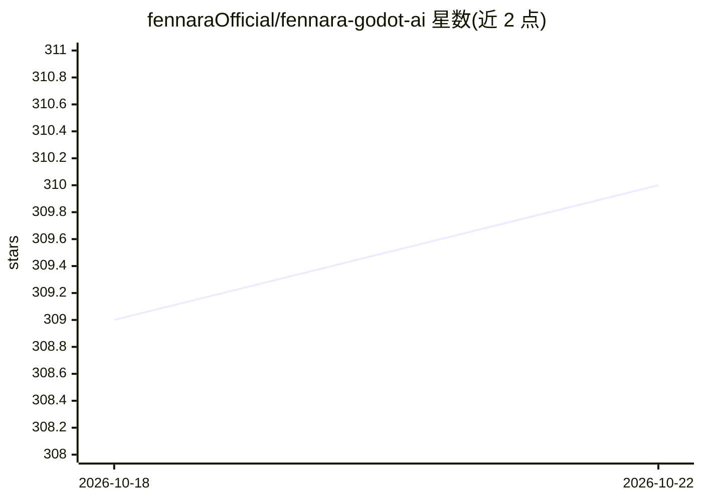

# fennaraOfficial/fennara-godot-ai

⭐ 311 · Rust · MIT · 推送 2026-10-22 · [GitHub](https://github.com/fennaraOfficial/fennara-godot-ai) · [官网](https://www.fennara.io) · 组织维护

**给 Godot 开发者的 AI 工具桥：让 AI 助手实时连接 Godot 编辑器**

Godot 编辑器插件加配套 CLI/本地 MCP 服务器与守护进程：通过 MCP 把场景树检查、脚本诊断、截图、运行日志、场景验证等编辑器内反馈暴露给 Claude、Codex、Cursor、Gemini 等外部 AI 编码应用；另提供编辑器内可选聊天 dock，支持 BYOK 云端密钥或 Ollama/LM Studio 本地服务。目标是给 agent 补上缺失的 Godot 反馈回路，而非替代其文件工具。要求 Godot 4.5+，仅桌面系统；导出时自动从游戏中移除运行时依赖；每日发送一次匿名遥测，可关闭。

## 筛选速览

| 维度 | 判定 | 备注 |
|---|---|---|
| AI 角色 | `ai-ecosystem` | LLM/agent 周边工具 |
| 许可风险 | `permissive` | MIT |
| 部署形态 | `desktop` | 安装包/桌面程序 |
| 模型依赖 | local-ok | 支持本地模型 |
| 硬件要求 | — | 无带数字的原话,不猜 |
| 安装摩擦 | `low` | 无编译、无系统依赖或容器化 |
| 成熟度 | — | 结构信号不足 |

## 能力要点

- 通过 MCP 向外部 AI 应用暴露场景树/诊断/截图/运行日志/场景验证等工具
- 编辑器内可选聊天 dock，支持 BYOK 云端或 Ollama/LM Studio 本地服务
- fennara CLI 安装并提供 mcp-setup/update/prepare-export 等命令
- 导出项目时自动剥离 addon 运行时依赖

## 适用场景

- 在 Claude/Codex/Cursor 等 MCP 应用中让 agent 基于编辑器实时反馈修改 Godot 项目
- 在 Godot 编辑器内直接使用 AI 聊天 dock 辅助开发
- 让 AI 验证场景改动并读取运行时错误

## 场景标签

`编码 Agent` · 领域:编码与开发

## 证据(README 行号)

> L26: - exposes Godot-aware tools to external AI apps through MCP
> L46: - a local MCP server used by AI coding apps

## 星数曲线

2026-10-18 309 → 2026-10-22 310（+1）

---
*卡片 v1 · prompt 1.4 · 生成 2026-10-21 · 置信度 high · 依据 README sha `e9318ac4aa26` · [字段定义](../../DATASET.md)*
