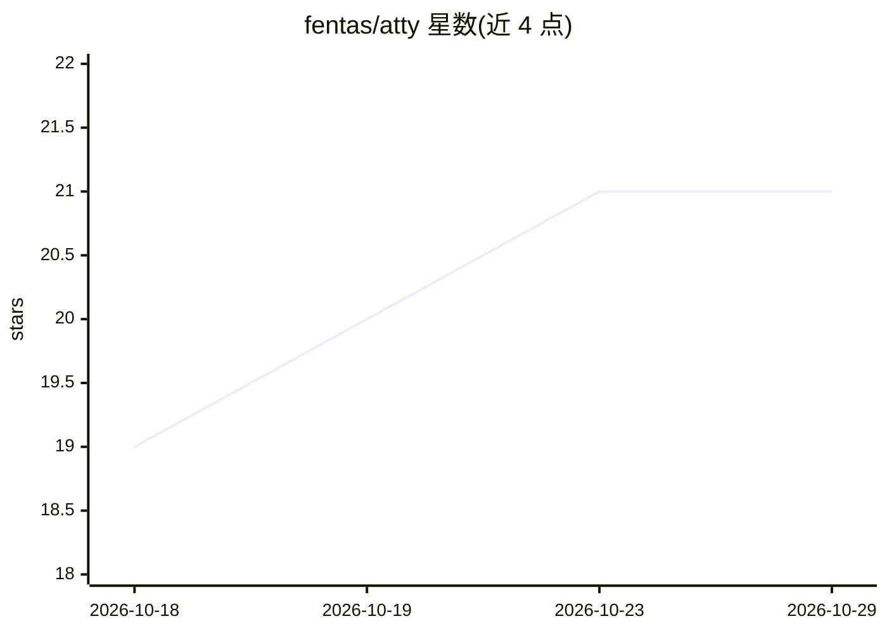

# fentas/atty

⭐ 21 · Zig · MIT · 推送 2026-07-30 · [GitHub](https://github.com/fentas/atty) · [官网](https://atty.sh) · 个人维护

**带 LLM 命令生成与危险命令防护的终端 PTY 代理**

用 Zig 编写的 Suckless 风格 PTY 代理：位于终端模拟器与 shell 之间，在编译期组合中间件模块——fish 式历史自动建议（Atuin 或 shell 原生历史）、危险命令确认拦截、#: 前缀自然语言生成命令（本地 Ollama、Claude/Gemini CLI 或任意 OpenAI 兼容端点）、路径/URL 点击打开，以及可选的 atty-guard 安全侧车（分级分类器、eBPF LSM、CVE 实时查询）。无运行时配置文件，编辑 src/config.zig 后重新编译即完成配置；发布为约 14 MB 的 musl 静态单二进制。README 声明代码主要由 LLM 生成、未经人工完整审查。

## 筛选速览

| 维度 | 判定 | 备注 |
|---|---|---|
| AI 角色 | `ai-enhanced` | 去掉 AI 部分产品仍成立 |
| 许可风险 | `permissive` | MIT |
| 部署形态 | `self-host` | docker 或自建部署 |
| 模型依赖 | local-ok | 支持本地模型 |
| 硬件要求 | — | 无带数字的原话,不猜 |
| 安装摩擦 | `low` | 无编译、无系统依赖或容器化 |
| 成熟度 | `idea` | |

## 能力要点

- #: intent → 命令，支持单次生成与多轮执行-观察-再提议对话
- 默认 guardrail 对 rm -rf /、curl|sh 等危险命令按规则 confirm/block/warn
- 编译期模块组合：禁用模块贡献零字节，热路径零堆分配
- 可选 atty-guard 侧车：分级分类器（regex+SLM/ONNX）、eBPF LSM、osv-live CVE 查询

## 适用场景

- 在日常 shell 工作流中获得自动建议与危险命令拦截
- 用自然语言让 LLM 生成并审阅命令行操作
- 为团队终端环境叠加 eBPF 内核级安全执行层

## 场景标签

`AI 助手` `代码生成` `网络安全` · 领域:编码与开发

## 证据(README 行号)

> L16: `atty` is a **Suckless-style PTY proxy** in Zig. It sits between your terminal emulator (Ghostty, Alacritty, kitty…
> L22: - **🛸 Autosuggestions** — fish-style dim/italic ghost text from your Atuin or shell-native history, served off a wo
> L23: - **🤖 LLM command mode** — type `#: deploy the staging stack`, press `Alt+A`, and the model writes the command onto

## 星数曲线

2026-10-18 19 → 2026-10-29 21（+2）

---
*卡片 v1 · prompt 1.4 · 生成 2026-10-28 · 置信度 mid · 依据 README sha `8b3eb9428292` · [字段定义](../../DATASET.md)*
