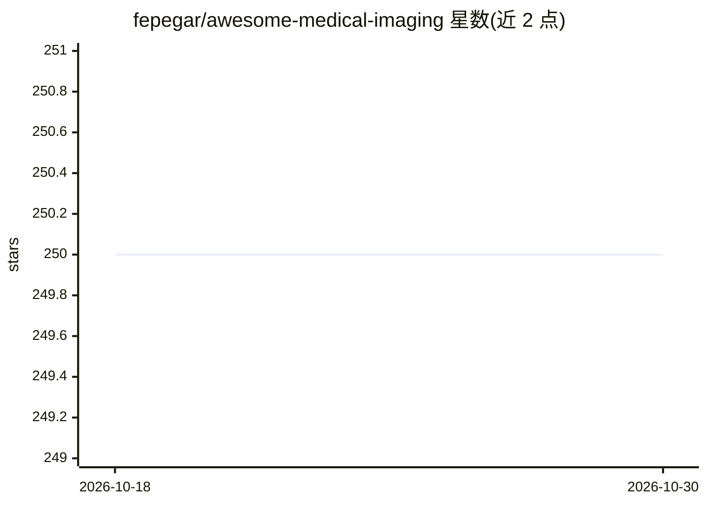

# fepegar/awesome-medical-imaging

⭐ 250 · CC0-1.0 · 推送 2026-03-17 · [GitHub](https://github.com/fepegar/awesome-medical-imaging) · 个人维护

**医学影像研究软件策展清单：收录工具与库**

由个人研究者维护的医学影像领域软件清单：按 Kitware 工具（ITK/VTK/3D Slicer）、NIPY 生态（Nipype/NiBabel）、神经影像（ANTs/SPM/FSL/FreeSurfer/MRtrix3）、配准、深度学习（NiftyNet）、文件格式（NIfTI/DICOM/NRRD）及 SciPy 生态等类别组织条目，每条附简介或项目链接，另有机器学习与计算机视觉通用库条目。清单本身不含可安装代码，条目链接指向各自仓库。

## 筛选速览

| 维度 | 判定 | 备注 |
|---|---|---|
| AI 角色 | `ai-knowledge` | 知识聚合/清单类 |
| 许可风险 | `viral` | CC0-1.0 |
| 部署形态 | `library` | 以包/库形式分发 |
| 模型依赖 | — | README 未给出锁定关系 |
| 硬件要求 | — | 无带数字的原话,不猜 |
| 安装摩擦 | `low` | 无编译、无系统依赖或容器化 |
| 成熟度 | — | 结构信号不足 |

## 能力要点

- 覆盖医学影像工具链：分割、配准、可视化、文件格式转换
- 按类别组织：Kitware、NIPY、神经影像、配准、深度学习、文件格式等
- 同时收录通用科学计算与机器学习库（NumPy/PyTorch/OpenCV 等）

## 适用场景

- 医学影像研究入门时查找领域常用工具
- 了解神经影像分析与处理软件生态

## 场景标签

`精选清单` · 领域:学习与行业

## 证据(README 行号)

> L4: This is an awesome list of software that I use to do research in medical imaging.
> L104: ### NiftyNet

## 星数曲线

2026-10-18 250 → 2026-10-30 250（+0）

---
*卡片 v1 · prompt 1.4 · 生成 2026-10-22 · 置信度 mid · 依据 README sha `1b81fc8f40aa` · [字段定义](../../DATASET.md)*
