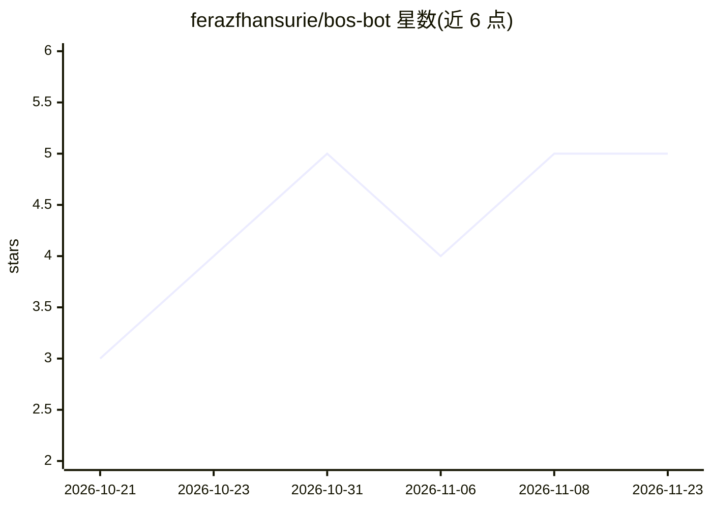

# ferazfhansurie/bos-bot

⭐ 5 · TypeScript · Apache-2.0 · 推送 2026-11-08 · [GitHub](https://github.com/ferazfhansurie/bos-bot) · [官网](https://bosbot.my) · 个人维护

**面向非技术企业主的群聊式 AI 员工操作系统**

开源的 AI 业务操作系统：非技术企业主在群聊里管理多名具名 AI bot，让它们回复 WhatsApp、投放广告、跟进线索，运行在自己已有的 Claude 或 ChatGPT 订阅之上。bot 通过本机的 claude/codex/grok CLI 运行，按 bot 或线程选模型；harness 服务器在 127.0.0.1 持有 agent 进程，对话与密钥留在本地。bot 执行 shell 命令、文件编辑前需在聊天中以卡片形式获得 Allow/Deny 批准。提供 macOS/Windows/Ubuntu 安装包及源码运行方式。

## 筛选速览

| 维度 | 判定 | 备注 |
|---|---|---|
| AI 角色 | `ai-native` | 本体是模型或模型工具 |
| 许可风险 | `permissive` | Apache-2.0 |
| 部署形态 | `desktop` | 安装包/桌面程序 |
| 模型依赖 | — | README 未给出锁定关系 |
| 硬件要求 | — | 无带数字的原话,不猜 |
| 安装摩擦 | `low` | 无编译、无系统依赖或容器化 |
| 成熟度 | — | 结构信号不足 |

## 能力要点

- @tag 唤醒单个 bot，团队多人共用一个房间而只消耗被点名 bot 的额度
- 每 bot 可选 Claude/Codex/Grok/本地模型，通过本机已登录的 agent CLI 运行
- bot 执行命令与编辑前出现批准卡片，本地 harness 服务器管理所有 agent 进程
- 通过 Composio 一键接入 Gmail、Slack、GitHub、Notion 等应用，并提供 stdio MCP 服务器

## 适用场景

- 让具名 AI bot 自动回复 WhatsApp 客户并跟进销售线索
- 团队与客户在同一个聊天室中与多个 AI 协作者协作
- 本地优先部署，让对话记录和 API 密钥保留在自己机器上

## 场景标签

`聊天机器人` `多智能体` · 领域:Agent 开发

## 证据(README 行号)

> L3: **Your own AI team in a group chat. Open source, any model, runs on your own computer.**
> L5: BOS Bot (bosbot.my) gives non-technical business owners named AI staff that answer WhatsApp, run ads and follow up l
> L163: |Drivers|`server/drivers/`|One per provider: Claude, Codex, and Grok Build over their local CLIs (stream-JSON / JS

## 星数曲线

2026-10-21 3 → 2026-11-23 5（+2）

---
*卡片 v1 · prompt 1.4 · 生成 2026-11-21 · 置信度 mid · 依据 README sha `805df2e174b7` · [字段定义](../../DATASET.md)*
