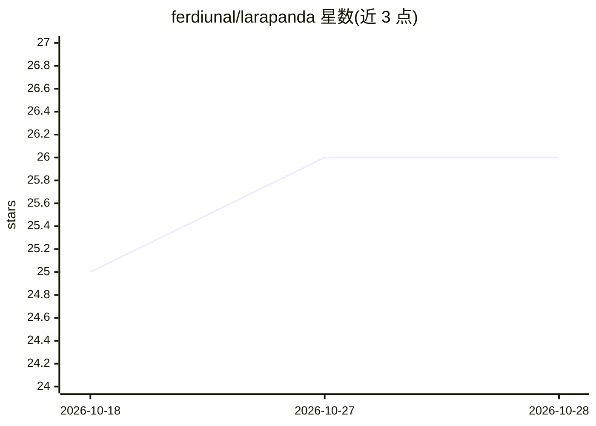

# ferdiunal/larapanda

⭐ 26 · PHP · MIT · 推送 2026-06-19 · [GitHub](https://github.com/ferdiunal/larapanda) · [官网](https://ferdiunal.tr) · 个人维护

**Laravel/PHP 的类型安全 Lightpanda SDK，接入浏览器抓取与 MCP**

面向 Laravel 与纯 PHP 开发者的 Lightpanda SDK：提供命名实例配置、运行时自动解析（auto/cli/docker）、fetch/serve/mcp 三类方法级不可变选项对象，输出 markdown 与 semantic tree 等强类型格式。CLI 模式依赖 Lightpanda 二进制，auto 模式优先 CLI、无二进制时回退 Docker。可选集成 laravel/ai 与 laravel/mcp，将 Lightpanda 工具暴露为 AI SDK 工具与 Laravel MCP 服务端工具，支持会话池、TTL、代理与工具暴露面配置。

## 筛选速览

| 维度 | 判定 | 备注 |
|---|---|---|
| AI 角色 | `ai-ecosystem` | LLM/agent 周边工具 |
| 许可风险 | `permissive` | MIT |
| 部署形态 | `None` |  |
| 模型依赖 | — | README 未给出锁定关系 |
| 硬件要求 | — | 无带数字的原话,不猜 |
| 安装摩擦 | `low` | 无编译、无系统依赖或容器化 |
| 成熟度 | — | 结构信号不足 |

## 能力要点

- fetch/serve/mcp 的不可变方法级选项对象与强类型输出访问器
- auto/cli/docker 运行时解析，auto 优先 CLI 否则回退 Docker
- AI SDK 与 Laravel MCP 服务端工具适配器（会话感知、代理策略、工具暴露面过滤）
- 命名实例配置：default/crawler/mcp 等按运行意图选择

## 适用场景

- 在 Laravel 应用中以类型安全方式调用 Lightpanda 抓取页面
- 将浏览器抓取/交互工具暴露给 LLM（AI SDK 或 MCP）做多步浏览任务
- 通过 Docker 或本地二进制灵活切换无头浏览器运行时

## 场景标签

`网页抓取` · 领域:效率与自动化

## 证据(README 行号)

> L12: Larapanda is a type-safe Lightpanda SDK for Laravel and plain PHP applications. It provides named instance profiles
> L148: Larapanda exposes AI SDK-compatible tools via `LarapandaAiTools`. The adapter is MCP-backed, session-aware, and co
> L188: Use this layer when you want Laravel-managed MCP registration, container wiring, config-based tool filtering, and 

## 星数曲线

2026-10-18 25 → 2026-10-28 26（+1）

---
*卡片 v1 · prompt 1.4 · 生成 2026-10-27 · 置信度 high · 依据 README sha `2cc9b76ad441` · [字段定义](../../DATASET.md)*
